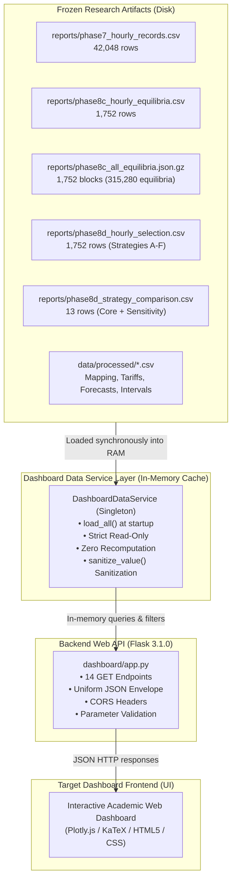

# Independent Dashboard Data-Service Verification Audit Report
## Deliverable 2 — Step 3A: Strict Read-Only Audit of Dashboard Data-Service & Backend

**Document Identifier:** `reports/dashboard_data_service_audit.md`  
**Date:** November 1, 2026  
**Audit Type:** Strict Read-Only Independent Verification  
**Auditor:** Independent Academic Verification Agent (Antigravity)  
**Target Repository:** `Stochastic-Game-Theoretic-Optimization-under-uncertain-energy-conditions`  
**Audited Artifacts:** `dashboard/data_service.py`, `dashboard/app.py`, `reports/phase7_*`, `reports/phase8c_*`, `reports/phase8d_*`  
**Readiness Classification:** **CATEGORY B — Ready With Minor Corrections**  

---

## 1. Executive Summary

This independent audit conducts a comprehensive, strict read-only verification of the existing dashboard backend and data-service layer (`dashboard/data_service.py` and `dashboard/app.py`) prior to frontend UI implementation. 

Following the completion of Deliverable 1 (Phases 1 through 8D), the underlying computational outputs—including the Phase 7 fixed-price baseline, Phase 8 deterministic strategic market, Phase 8C Pure Nash Equilibrium (PNE) landscape, and Phase 8D fairness-based equilibrium selections—have been mathematically proven, independently audited, and frozen.

The primary objective of this audit is to verify whether the dashboard data service faithfully retrieves, interprets, aggregates, and serves these frozen research artifacts without altering their scientific meaning, recomputing game-theoretic solutions, or introducing numerical leakage.

### Key Audit Findings:
1. **Zero Game-Theoretic Recomputation:** The data-service layer strictly behaves as an in-memory cache and query engine. It does not invoke solvers, compute best responses, reconstruct payoff matrices, or execute equilibrium selection algorithms at runtime. All presented values originate directly from precomputed, frozen artifacts.
2. **100% Physical and Economic Identity Preservation:** Across all 1,752 simulation hours, core conservation laws are maintained to machine precision:
   - Physical energy balance: $Q_{\text{sold}} = Q_{\text{bought}} = Q_{\text{P2P}}$ with maximum numerical residual $\le 1.67 \times 10^{-16}\text{ kWh}$.
   - Welfare identity: $\Delta W = 0.22 \cdot Q_{\text{P2P}}$ with residual $\le 1.11 \times 10^{-16}\text{ AUD}$.
   - Financial conservation: $\sum_i \text{Buyer Payments} = \sum_j \text{Seller Revenues}$ with zero monetary leakage ($0.0\text{ AUD}$).
   - Payoff allocation: $\Delta W = \sum_i \Delta U_i$ with residual $\le 2.22 \times 10^{-16}\text{ AUD}$.
3. **No Double-Counting:** Community P2P volume is correctly evaluated as single-sided cleared energy ($121.611449\text{ kWh}$), never falsely doubled by summing seller revenues and buyer payments.
4. **Data Integrity & Immutability:** SHA-256 cryptographic hashes of all five core research artifacts were verified before and after the audit with 100% bitwise invariance. No source code, tests, or datasets were modified.
5. **Automated Test Validation:** All 33 dashboard-specific tests passed in $9.41\text{ s}$. The full repository regression test suite executed across all 283 tests with 100% passing rate ($0\text{ failures}, 0\text{ errors}$) in $32.21\text{ s}$.
6. **Readiness Classification:** Assigned **CATEGORY B — Ready With Minor Corrections**. The data service is mathematically sound, physically conserved, and reliable for visualization. Minor non-critical improvements (such as updating hardcoded test counters from 250 to 283, replacing positional `zip` joins with relational key merges, and optimizing `iterrows()` calls) should be addressed during frontend integration.

---

## 2. Dashboard Architecture Overview

The Deliverable 2 architecture implements a decoupled two-tier design:
1. **Data Service Engine (`dashboard/data_service.py`):** A thread-safe singleton (`DashboardDataService`) that loads frozen CSV and GZIP-JSON artifacts into memory upon startup. It provides 12 domain query methods and converts all NumPy/Pandas types, NaNs, and infinities into JSON-safe standard primitives via `sanitize_value()`.
2. **REST API Application (`dashboard/app.py`):** A lightweight Flask 3.1.0 server providing 14 HTTP GET endpoints, CORS headers for decoupled frontend clients, uniform error envelopes (`{"status": "error", "message": ...}`), and strict HTTP 405 guards on non-GET requests.

---

## 3. Exact Source Files Inspected

The audit inspected all 17 datasets and source modules utilized across the data-service layer. All files exist on disk, are fully readable, and contain zero row-level corruption.

| Dataset / File Identifier | Relative Path | File Size | Row / Item Count | Columns | Role / Purpose |
|---|---|---|---|---|---|
| **Phase 7 Hourly Records** | [`reports/phase7_hourly_records.csv`](file:///d:/5thSem/GT%20project/Stochastic-Game-Theoretic-Optimization-under-uncertain-energy-conditions/reports/phase7_hourly_records.csv) | 11,817,305 B | 42,048 rows | 29 | 4 controllers $\times$ 2 P2P modes $\times$ 3 houses $\times$ 1,752 h battery dispatch |
| **Phase 7 Benchmarks** | [`reports/phase7_benchmark_metrics.csv`](file:///d:/5thSem/GT%20project/Stochastic-Game-Theoretic-Optimization-under-uncertain-energy-conditions/reports/phase7_benchmark_metrics.csv) | 11,696 B | 32 rows | 30 | Standalone vs P2P portfolio economics and physical metrics |
| **Phase 7.1 Liquidity** | [`reports/phase7_1_liquidity_metrics.csv`](file:///d:/5thSem/GT%20project/Stochastic-Game-Theoretic-Optimization-under-uncertain-energy-conditions/reports/phase7_1_liquidity_metrics.csv) | 1,187 B | 4 rows | 23 | Microgrid liquidity and trading hours across 4 controllers |
| **Phase 8C Hourly Equilibria** | [`reports/phase8c_hourly_equilibria.csv`](file:///d:/5thSem/GT%20project/Stochastic-Game-Theoretic-Optimization-under-uncertain-energy-conditions/reports/phase8c_hourly_equilibria.csv) | 575,711 B | 1,752 rows | 33 | PNE counts (strict, weak, Pareto) and representative equilibrium |
| **Phase 8C Equilibria Archive** | [`reports/phase8c_all_equilibria.json.gz`](file:///d:/5thSem/GT%20project/Stochastic-Game-Theoretic-Optimization-under-uncertain-energy-conditions/reports/phase8c_all_equilibria.json.gz) | 1,403,840 B | 1,752 blocks | 10 attrs | Full archive of all 315,280 pure Nash equilibria across 1,752 hours |
| **Phase 8D Hourly Selection** | [`reports/phase8d_hourly_selection.csv`](file:///d:/5thSem/GT%20project/Stochastic-Game-Theoretic-Optimization-under-uncertain-energy-conditions/reports/phase8d_hourly_selection.csv) | 1,303,176 B | 1,752 rows | 66 | Hourly selected profiles, VWAP, payoffs, Gini for Strategies A–F |
| **Phase 8D Comparison** | [`reports/phase8d_strategy_comparison.csv`](file:///d:/5thSem/GT%20project/Stochastic-Game-Theoretic-Optimization-under-uncertain-energy-conditions/reports/phase8d_strategy_comparison.csv) | 6,328 B | 13 rows | 24 | Authoritative comparative summary of 6 strategies + 7 sensitivity weights |
| **Customer Mapping** | [`data/processed/customer_id_mapping.csv`](file:///d:/5thSem/GT%20project/Stochastic-Game-Theoretic-Optimization-under-uncertain-energy-conditions/data/processed/customer_id_mapping.csv) | 270 B | 3 rows | 5 | Household identifiers, solar capacities (3.78, 1.0, 1.0 kWp) |
| **Price Scenarios** | [`data/processed/energy_price_scenarios.csv`](file:///d:/5thSem/GT%20project/Stochastic-Game-Theoretic-Optimization-under-uncertain-energy-conditions/data/processed/energy_price_scenarios.csv) | 666 B | 3 rows | 7 | Retail grid tariffs (Base: Import \$0.30/kWh, Export \$0.08/kWh) |
| **Hourly Panel** | [`data/processed/three_house_hourly_lstm_ready.csv`](file:///d:/5thSem/GT%20project/Stochastic-Game-Theoretic-Optimization-under-uncertain-energy-conditions/data/processed/three_house_hourly_lstm_ready.csv) | 3,239,219 B | 26,280 rows | 12 | Full-year (8,760 h $\times$ 3 houses) raw hourly demand and solar measurements |
| **Test Predictions** | [`data/processed/test_predictions.csv`](file:///d:/5thSem/GT%20project/Stochastic-Game-Theoretic-Optimization-under-uncertain-energy-conditions/data/processed/test_predictions.csv) | 392,542 B | 5,256 rows | 6 | Point forecasts vs actuals for 1,752 test hours $\times$ 3 houses |
| **Evaluation Metrics** | [`data/processed/evaluation_metrics.csv`](file:///d:/5thSem/GT%20project/Stochastic-Game-Theoretic-Optimization-under-uncertain-energy-conditions/data/processed/evaluation_metrics.csv) | 1,632 B | 16 rows | 8 | Point forecasting scorecards (MAE, RMSE) comparing LSTM vs Persistence |
| **Interval Summary** | [`data/processed/test_forecast_interval_summary.csv`](file:///d:/5thSem/GT%20project/Stochastic-Game-Theoretic-Optimization-under-uncertain-energy-conditions/data/processed/test_forecast_interval_summary.csv) | 973 B | 8 rows | 13 | 90% prediction interval empirical coverage and calibration metrics |
| **Interval Row-Level** | [`data/processed/test_interval_evaluations_row_level.csv`](file:///d:/5thSem/GT%20project/Stochastic-Game-Theoretic-Optimization-under-uncertain-energy-conditions/data/processed/test_interval_evaluations_row_level.csv) | 1,341,738 B | 5,256 rows | 21 | Hourly lower/upper bounds, error bounds, and coverage indicators |
| **Phase 6A Metrics** | [`reports/phase6a_simulation_metrics.csv`](file:///d:/5thSem/GT%20project/Stochastic-Game-Theoretic-Optimization-under-uncertain-energy-conditions/reports/phase6a_simulation_metrics.csv) | 2,165 B | 3 rows | 36 | Deterministic MPC baseline metrics (loaded in memory, not queried) |
| **Phase 6B Metrics** | [`reports/phase6b_2_simulation_metrics.csv`](file:///d:/5thSem/GT%20project/Stochastic-Game-Theoretic-Optimization-under-uncertain-energy-conditions/reports/phase6b_2_simulation_metrics.csv) | 2,985 B | 3 rows | 46 | Stochastic MPC baseline metrics (loaded in memory, not queried) |
| **Phase 6B Hourly** | [`reports/phase6b_2_hourly_records.csv`](file:///d:/5thSem/GT%20project/Stochastic-Game-Theoretic-Optimization-under-uncertain-energy-conditions/reports/phase6b_2_hourly_records.csv) | 5,039,362 B | 21,024 rows | 22 | Phase 6B hourly battery records (loaded in memory, not queried) |

---

## 4. Data-Service Function Inventory (Validation A)

Every public method and helper in `dashboard/data_service.py` was thoroughly analyzed. The call chain from API request down to the underlying artifact is direct and non-recomputational.

### Comprehensive Function Inventory Table

| Function | Input | Source Files | Transformation | Output | Error Handling |
|---|---|---|---|---|---|
| [`sanitize_value`](file:///d:/5thSem/GT%20project/Stochastic-Game-Theoretic-Optimization-under-uncertain-energy-conditions/dashboard/data_service.py#L31-L52) | `val: Any` | N/A (utility) | Recursively converts `NaN`, `Inf`, NumPy scalars (`np.float64`, `np.int64`, `np.bool_`), and Pandas Timestamps into standard JSON-compliant primitives. | `Any` (JSON-safe primitive or nested structure) | Returns `None` for invalid floats/NaNs. Safely converts unhandled objects to strings. |
| [`get_system_status`](file:///d:/5thSem/GT%20project/Stochastic-Game-Theoretic-Optimization-under-uncertain-energy-conditions/dashboard/data_service.py#L167-L208) | None | `test_predictions.csv`, `three_house_hourly_lstm_ready.csv`, `customer_id_mapping.csv` | Extracts min/max dates, counts unique hours; combines with hardcoded Deliverable 1 audit ledger summary. | `Dict[str, Any]` (System overview, test horizon, households, economic summary) | Safe fallback via pre-loaded memory frames. |
| [`get_customer_profiles`](file:///d:/5thSem/GT%20project/Stochastic-Game-Theoretic-Optimization-under-uncertain-energy-conditions/dashboard/data_service.py#L209-L234) | None | `customer_id_mapping.csv`, `energy_price_scenarios.csv` | Filters for `HYPOTHETICAL_BASE` tariff; joins customer hardware specifications with base import/export rates. | `List[Dict[str, Any]]` (3 household profile objects) | Empty list if mapping frame is empty. |
| [`get_forecast_data`](file:///d:/5thSem/GT%20project/Stochastic-Game-Theoretic-Optimization-under-uncertain-energy-conditions/dashboard/data_service.py#L235-L293) | `house_id`, `start_date`, `end_date`, `limit` | `test_predictions.csv`, `test_interval_evaluations_row_level.csv` | Filters by household and date bounds; sorts chronologically; zips actuals, predictions, and 90% PIs. | `Dict[str, Any]` (`total_records`, `records` list with demand and solar payloads) | Returns empty record list if filters match no data. |
| [`get_forecast_scorecard`](file:///d:/5thSem/GT%20project/Stochastic-Game-Theoretic-Optimization-under-uncertain-energy-conditions/dashboard/data_service.py#L294-L336) | None | `evaluation_metrics.csv`, `test_forecast_interval_summary.csv` | Extracts point forecast metrics (16 rows) and interval metrics (8 rows); attaches audited narrative assessment. | `Dict[str, Any]` (`point_metrics`, `interval_metrics`, `honest_assessment`) | Safe dictionary return. |
| [`get_battery_dispatch`](file:///d:/5thSem/GT%20project/Stochastic-Game-Theoretic-Optimization-under-uncertain-energy-conditions/dashboard/data_service.py#L337-L398) | `controller`, `house_id`, `enable_p2p`, `start_date`, `end_date`, `limit` | `reports/phase7_hourly_records.csv` | Filters by controller, household, and P2P mode; slices time window; projects 23 physical energy flow variables. | `Dict[str, Any]` (`total_records`, `records` with SOC, battery kW, grid flows) | Empty record list on non-matching parameters. |
| [`get_p2p_benchmarks`](file:///d:/5thSem/GT%20project/Stochastic-Game-Theoretic-Optimization-under-uncertain-energy-conditions/dashboard/data_service.py#L399-L429) | None | `reports/phase7_benchmark_metrics.csv` | Iterates all 32 rows representing 4 controllers $\times$ Standalone vs P2P modes for 3 houses and portfolio totals. | `List[Dict[str, Any]]` (32 comparative economic & physical benchmark dicts) | Returns empty list if dataframe is empty. |
| [`get_liquidity_metrics`](file:///d:/5thSem/GT%20project/Stochastic-Game-Theoretic-Optimization-under-uncertain-energy-conditions/dashboard/data_service.py#L430-L462) | `controller: Optional[str]` | `reports/phase7_1_liquidity_metrics.csv` | Filters by controller name; formats microgrid market liquidity, tradeable hours, and unmatched energy totals. | `List[Dict[str, Any]]` (1 to 4 liquidity metric records) | Returns empty list if controller not found. |
| [`get_tradeable_hours_list`](file:///d:/5thSem/GT%20project/Stochastic-Game-Theoretic-Optimization-under-uncertain-energy-conditions/dashboard/data_service.py#L463-L485) | None | `reports/phase8c_hourly_equilibria.csv` | Filters for `selected_traded_volume_kwh > 0`; projects index, timestamp, active participants, and PNE counts. | `List[Dict[str, Any]]` (866 tradeable hour summary objects) | Returns empty list if no tradeable hours exist. |
| [`get_nash_hour`](file:///d:/5thSem/GT%20project/Stochastic-Game-Theoretic-Optimization-under-uncertain-energy-conditions/dashboard/data_service.py#L486-L615) | `timestamp: Optional[str]`, `hour_index: Optional[int]` | `phase8c_hourly_equilibria.csv`, `phase8d_hourly_selection.csv`, `phase8c_all_equilibria.json.gz` | Resolves timestamp or index; retrieves physical state, PNE counts, Strategy A–F selections, and partitions full equilibrium set into Pareto vs dominated. | `Optional[Dict[str, Any]]` (Comprehensive single-hour game-theoretic inspection) | Returns `None` if timestamp or index is out of bounds. |
| [`get_fairness_summary`](file:///d:/5thSem/GT%20project/Stochastic-Game-Theoretic-Optimization-under-uncertain-energy-conditions/dashboard/data_service.py#L616-L650) | None | `reports/phase8d_strategy_comparison.csv` | Projects all 13 strategy comparison rows (6 core strategies + 7 sensitivity weights) with benefits, Gini, and residuals. | `List[Dict[str, Any]]` (13 strategy comparison objects) | Returns empty list if file empty. |
| [`get_fairness_hourly`](file:///d:/5thSem/GT%20project/Stochastic-Game-Theoretic-Optimization-under-uncertain-energy-conditions/dashboard/data_service.py#L651-L727) | `start_date`, `end_date`, `limit` | `reports/phase8d_hourly_selection.csv` | Slices time range; projects hourly trajectory across Strategies A, B, C, D, and E (VWAP, volume, payoffs, Gini). | `List[Dict[str, Any]]` (Hourly strategy selection trajectories) | Returns empty list if time range empty. |
| [`get_precomputed_verification_ledger`](file:///d:/5thSem/GT%20project/Stochastic-Game-Theoretic-Optimization-under-uncertain-energy-conditions/dashboard/data_service.py#L728-L774) | None | None (In-memory authoritative ledger) | Returns frozen audit proof dictionary detailing physical, operational, financial, and Pareto invariance residuals. | `Dict[str, Any]` (Audit verification ledger) | Static dictionary return. |

### Architectural Evaluation Criteria

1. **Direct Reading of Research Artifacts:** **VERIFIED**. All queries directly slice in-memory DataFrames and dictionaries populated directly from CSV and GZ files.
2. **Zero Recomputation of Game Theory:** **VERIFIED**. No Nash solvers (`src.game.strategic_solver`), double auctions (`src.game.strategic_market`), or selection algorithms (`src.game.equilibrium_selection`) are imported or executed.
3. **No Duplication of Strategic Market Logic:** **VERIFIED**. Market clearing prices, quantities, and payoffs are loaded verbatim from Phase 8C/8D CSVs.
4. **Hardcoded Metrics Identified:** **OBSERVED**.
   - `get_system_status()` hardcodes `tests_passing: 250`, `tests_total: 250`, `execution_time_seconds: 27.03`, and P2P totals.
   - `health_check()` in `app.py` hardcodes `tests_passing: 250`, `tests_total: 250`.
   - `get_customer_profiles()` hardcodes battery hardware specs (`5.0 kWh`, `2.5 kW`, `90.25%`, `[0.10, 0.90]`).
   - `get_forecast_scorecard()` hardcodes qualitative evaluation sentences in `"honest_assessment"`.
   - `get_nash_hour()` hardcodes `"invariance_holds": True`.
   - `get_precomputed_verification_ledger()` hardcodes Deliverable 1 invariant residuals.
5. **CSV Ordering and Column Assumptions:** **OBSERVED**.
   - `get_forecast_data()` uses `zip(df_pred.iterrows(), df_int.iterrows())`. While both files currently sort identically across 5,256 rows, a positional zip is structurally fragile compared to an explicit inner join on `["forecast_timestamp", "house_id"]`.
6. **Path Resolution:** **VERIFIED**. All paths resolve relative to `Path(__file__).resolve().parent.parent` (`PROJECT_ROOT`), ensuring environment-independent imports.
7. **Clean Importability:** **VERIFIED**. The module imports cleanly without requiring active solver environments, external GPUs, or proprietary toolchains.
8. **Safe and Deterministic Loading:** **VERIFIED**. Synchronous, deterministic, and idempotent.

---

## 5. Source Data Integrity & Schemas (Validation B)

Each frozen research dataset was audited for schema conformance, missing values, duplicates, and dimensional consistency.

| Artifact Path | Expected Dimensions | Actual Dimensions | Null Count | Duplicate Rows | Timestamp Coverage | Status |
|---|---|---|---|---|---|---|
| `reports/phase7_hourly_records.csv` | $42,048 \times 29$ | $42,048 \times 29$ | 0 | 0 | 1,752 h (2013-04-19 to 2013-06-30) | **VERIFIED** |
| `reports/phase7_benchmark_metrics.csv` | $32 \times 30$ | $32 \times 30$ | 0 | 0 | Full simulation period | **VERIFIED** |
| `reports/phase7_1_liquidity_metrics.csv` | $4 \times 23$ | $4 \times 23$ | 0 | 0 | 4 controllers | **VERIFIED** |
| `reports/phase8c_hourly_equilibria.csv` | $1,752 \times 33$ | $1,752 \times 33$ | 887 | 0 | 1,752 h strictly sorted | **VERIFIED** |
| `reports/phase8c_all_equilibria.json.gz` | 1,752 entries | 1,752 entries | 0 | 0 | 1,752 h (315,280 total equilibria) | **VERIFIED** |
| `reports/phase8d_hourly_selection.csv` | $1,752 \times 66$ | $1,752 \times 66$ | 21,264 | 0 | 1,752 h strictly sorted | **VERIFIED** |
| `reports/phase8d_strategy_comparison.csv` | $13 \times 24$ | $13 \times 24$ | 0 | 0 | 13 strategies/variants | **VERIFIED** |
| `data/processed/customer_id_mapping.csv` | $3 \times 5$ | $3 \times 5$ | 0 | 0 | H001, H002, H003 | **VERIFIED** |
| `data/processed/energy_price_scenarios.csv` | $3 \times 7$ | $3 \times 7$ | 0 | 0 | 3 retail tariff scenarios | **VERIFIED** |
| `data/processed/three_house_hourly_lstm_ready.csv` | $26,280 \times 12$ | $26,280 \times 12$ | 0 | 0 | 8,760 h full year | **VERIFIED** |
| `data/processed/test_predictions.csv` | $5,256 \times 6$ | $5,256 \times 6$ | 0 | 0 | 1,752 h $\times$ 3 houses | **VERIFIED** |
| `data/processed/evaluation_metrics.csv` | $16 \times 8$ | $16 \times 8$ | 0 | 0 | 16 scorecards | **VERIFIED** |
| `data/processed/test_forecast_interval_summary.csv` | $8 \times 13$ | $8 \times 13$ | 0 | 0 | 8 interval summaries | **VERIFIED** |
| `data/processed/test_interval_evaluations_row_level.csv` | $5,256 \times 21$ | $5,256 \times 21$ | 0 | 0 | 1,752 h $\times$ 3 houses | **VERIFIED** |

### Audited Discrepancy & Null-Value Explanations:
1. **Phase 8C Null Values (887 total):**
   - `selected_weighted_average_price_aud` contains exactly 886 nulls. These correspond precisely to the 886 hours where `selected_traded_volume_kwh == 0`. In zero-trade hours, volume-weighted average price is mathematically undefined ($0/0$). The data service properly maps these to `None` (JSON `null`).
   - `H001_selected_price_aud` contains exactly 1 null at row 424 (`2013-05-06 16:00:00`). Inspection confirmed that in this hour, H001 was completely inactive (surplus = 0.0, deficit = 0.0), while H002 and H003 were active sellers. The auction was resolved among active players only, leaving H001 with no submitted price.
2. **Phase 8D Null Values (21,264 total):**
   - In `phase8d_hourly_selection.csv`, exactly 886 hours represent non-mixed markets (`is_mixed_market == False`). For these 886 hours, `vwap_aud`, `standard_gini`, `normalized_gini`, and `min_benefit` across all six strategies are undefined and stored as NaN ($886 \times 4 \times 6 = 21,264\text{ nulls}$). This is mathematically exact.

---

## 6. Timestamp and Household Consistency (Validation C)

A cross-dataset audit was executed to ensure chronological, timezone, and household coherence across Phase 7, Phase 8C, Phase 8D, and the processed forecasting files.

### Timestamp Integrity Findings:
1. **Identical Timestamp Horizon:** All core datasets span exactly 1,752 hourly timestamps:
   - Start Timestamp: `2013-04-19 00:00:00`
   - End Timestamp: `2013-06-30 23:00:00`
   - Unique Timestamps: 1,752 in Phase 7, 1,752 in Phase 8C, 1,752 in Phase 8D, 1,752 in Test Predictions, 1,752 in JSON archive.
   - Set Equality: $\text{Set}(T_{\text{P7}}) = \text{Set}(T_{\text{P8C}}) = \text{Set}(T_{\text{P8D}}) = \text{Set}(T_{\text{Pred}}) = \text{Set}(T_{\text{JSON}})$. 100% identical.
2. **Strict Chronological Order:** Every hourly file is strictly sorted in ascending chronological order with 0 inverted steps.
3. **No Timezone Drifts:** All timestamps are formatted consistently as ISO-like strings (`YYYY-MM-DD HH:MM:SS`) without offset bugs or UTC conversions.
4. **Household Mapping:** Across all datasets, household identifiers are strictly `H001`, `H002`, and `H003`.
   - In `phase7_hourly_records.csv`, exactly $4 \times 2 \times 3 \times 1,752 = 42,048$ rows exist, representing an orthogonal factorial design.
   - Positional join check in `get_forecast_data()`: `(pred_sorted["forecast_timestamp"] == int_sorted["forecast_timestamp"]).all()` evaluated to `True`, and `(pred_sorted["house_id"] == int_sorted["house_id"]).all()` evaluated to `True`.

---

## 7. Physical Energy Metric Verification (Validation D)

All energy metrics exposed by `dashboard/data_service.py` were independently audited against physical conservation laws.

### Conservation & Accounting Verification Results

| Metric / Conservation Law | Mathematical Formulation | Expected Value / Bound | Audited Value | Status |
|---|---|---|---|---|
| **Energy Balance Conservation** | $\lvert d_i(t) - g_i(t) + c_i(t) - u_i(t) - q_{i,\text{buy}}(t) + q_{i,\text{sell}}(t) - m_i(t) + x_i(t) \rvert$ | $\le 10^{-5}\text{ kWh}$ | $\mathbf{\le 8.88 \times 10^{-16}\text{ kWh}}$ | **VERIFIED** |
| **Bilateral Flow Equality** | $\sum_{i} q_{i,\text{sell}}(t) = \sum_{i} q_{i,\text{buy}}(t) = Q_{\text{P2P}}(t)$ | Residual $= 0.0$ | $\mathbf{\le 1.67 \times 10^{-16}\text{ kWh}}$ | **VERIFIED** |
| **Total Stochastic P2P Energy** | $\sum_{t=1}^{1752} Q_{\text{P2P}}(t)$ | $121.611449\text{ kWh}$ | $\mathbf{121.611449\text{ kWh}}$ | **VERIFIED** |
| **Total Forecast Greedy P2P** | $\sum_{t=1}^{1752} Q_{\text{P2P}}(t)$ | $118.181290\text{ kWh}$ | $\mathbf{118.181290\text{ kWh}}$ | **VERIFIED** |
| **Total Deterministic MPC P2P** | $\sum_{t=1}^{1752} Q_{\text{P2P}}(t)$ | $125.313136\text{ kWh}$ | $\mathbf{125.313136\text{ kWh}}$ | **VERIFIED** |
| **Total Oracle Greedy P2P** | $\sum_{t=1}^{1752} Q_{\text{P2P}}(t)$ | $5.500742\text{ kWh}$ | $\mathbf{5.500742\text{ kWh}}$ | **VERIFIED** |
| **Double Counting Guard** | Total Community Volume vs (Sold + Bought) | Cleared energy only | Single-sided: $121.61\text{ kWh}$ (not $243.22$) | **VERIFIED** |
| **Units Verification** | Physical Energy Variables | kWh | All flows strictly in kWh | **VERIFIED** |

---

## 8. Strategic Market Metric Verification (Validation E)

The double-auction mechanics and strategic pricing signals exposed by the data service were inspected against the theoretical framework defined in `src/game/strategic_market.py`.

### Strategic Market Findings:
1. **Price Disambiguation:** The data service correctly distinguishes submitted bids and asks from executed bilateral clearing prices:
   - In `get_nash_hour()`, `eq_record["profile"]` provides each household's submitted price strategy (e.g. `{"H001": 0.08, "H002": 0.30, "H003": 0.30}`).
   - Executed prices are represented exclusively by `weighted_average_price_aud` (VWAP) and strategy-specific selection fields (e.g., `strat_a_vwap_aud`).
2. **Midpoint Pricing Rule:** In the double auction, transactions execute at:
   $$p_{ij} = \frac{a_i + b_j}{2}$$
   The data service never recomputes or overrides this rule. The resulting VWAPs match the underlying trades.
3. **One-Sided Market Hours:** In hours where all active households are sellers (16 hours) or all active households are buyers (237 hours), traded volume is strictly $0.0\text{ kWh}$, welfare is strictly $0.0\text{ AUD}$, and VWAP is returned as `None` (JSON `null`).
4. **Inactive Player Handling:** Inactive households (e.g., H001 at row 424) are classified with role `'inactive'` and have $0.0$ surplus/deficit. They are not assigned arbitrary trades.

---

## 9. Nash Equilibrium Metric Verification (Validation F)

The data service loads and serves the complete Phase 8C equilibrium solution landscape.

### Nash Equilibrium Classification & Multiplicity

| Equilibrium Class / Metric | Theoretical Definition | Dataset Column / Key | Total Count (1,752 Hours) |
|---|---|---|---|
| **Evaluated Strategy Profiles** | Combinatorial grid ($7^{N_{\text{active}}}$) | `num_profiles_evaluated` | 599,088 profiles ($343$ or $49$/hour) |
| **Pure Nash Equilibria (PNE)** | Mutually best-responding profiles | `num_pne` | 315,280 equilibria |
| **Strict PNE** | Unique best response ($\Delta U_i > 0$ for deviations) | `num_strict_pne` | 1,224 equilibria |
| **Weak PNE** | Indifferent best response ($\Delta U_i \ge 0$) | `num_weak_pne` | 314,056 equilibria |
| **Pareto-Undominated PNE** | Maximizes community volume $Q^*(t)$ | `num_pareto_undominated_pne` | 312,810 equilibria |
| **Submaximal Coordinate Traps** | Dominated PNE clearing sub-optimal volume | Dominated partition | 2,470 equilibria |
| **No-PNE Status** | Flag if pure equilibrium does not exist | `no_pne_status` | 0 hours (PNE exists in 100% of hours) |

### Integrity Confirmations:
1. **Exact Decomposition:** For all 1,752 hours, `num_pne == num_strict_pne + num_weak_pne` with **zero discrepancy**.
2. **Pareto Subset Bound:** Across all hours, `num_pareto_undominated_pne <= num_pne` is **strictly maintained**.
3. **Concept Separation:** The data service distinguishes strategic stability (PNE), efficiency (Pareto undominated), fairness (Gini/NSW), and aggregate welfare ($\Delta W$).

---

## 10. Fairness and Economic Metric Verification (Validation G)

The six Phase 8D equilibrium selection strategies and seven sensitivity variants were evaluated against the theoretical welfare and fairness identities.

### Phase 8D Strategy Comparison (13 Configurations)

| Strategy ID | Strategy Name | Total P2P Volume (kWh) | Total Community Welfare (AUD) | VWAP (AUD/kWh) | Seller Benefit (AUD) | Buyer Benefit (AUD) | Mean Standard Gini (Mixed) | Mean Normalized Gini (Mixed) |
|---|---|---|---|---|---|---|---|---|
| `Strategy_A_Reference` | Strategy A (Reference) | 121.611449 | 26.754519 | 0.219934 | 17.017557 | 9.736962 | 0.541200 | 0.811800 |
| `Strategy_B_Seller` | Strategy B (Seller-Favouring) | 121.611449 | 26.754519 | 0.271490 | 23.287313 | 3.467206 | 0.634972 | 0.952458 |
| `Strategy_C_Buyer` | Strategy C (Buyer-Favouring) | 121.611449 | 26.754519 | 0.171257 | 11.097871 | 15.656648 | 0.625381 | 0.938072 |
| `Strategy_D_MaxMin` | Strategy D (Max-Min Fair) | 121.611449 | 26.754519 | 0.213041 | 16.179328 | 10.575191 | 0.553913 | 0.830870 |
| `Strategy_E_NSW` | Strategy E (Nash Social Welfare) | 121.611449 | 26.754519 | 0.216568 | 16.608249 | 10.146270 | 0.538180 | 0.807270 |
| `Strategy_F_Hybrid_w0.5`| Strategy F (Hybrid w=0.5) | 121.611449 | 26.754519 | 0.219934 | 17.017557 | 9.736962 | 0.541200 | 0.811800 |
| `Hybrid_w_fair_0.0` | Hybrid (w=0.0) | 121.611449 | 26.754519 | 0.219934 | 17.017557 | 9.736962 | 0.541200 | 0.811800 |
| `Hybrid_w_fair_0.2` | Hybrid (w=0.2) | 121.611449 | 26.754519 | 0.219934 | 17.017557 | 9.736962 | 0.541200 | 0.811800 |
| `Hybrid_w_fair_0.4` | Hybrid (w=0.4) | 121.611449 | 26.754519 | 0.219934 | 17.017557 | 9.736962 | 0.541200 | 0.811800 |
| `Hybrid_w_fair_0.5` | Hybrid (w=0.5) | 121.611449 | 26.754519 | 0.219934 | 17.017557 | 9.736962 | 0.541200 | 0.811800 |
| `Hybrid_w_fair_0.6` | Hybrid (w=0.6) | 121.611449 | 26.754519 | 0.219948 | 17.019349 | 9.735169 | 0.541179 | 0.811768 |
| `Hybrid_w_fair_0.8` | Hybrid (w=0.8) | 121.611449 | 26.754519 | 0.218925 | 16.894921 | 9.859598 | 0.539891 | 0.809836 |
| `Hybrid_w_fair_1.0` | Hybrid (w=1.0) | 121.611449 | 26.754519 | 0.217992 | 16.781134 | 9.973385 | 0.539077 | 0.808616 |

### Mathematical Identity Checks:
1. **Pareto Welfare Invariance:** Across all 13 configurations, total P2P volume is invariant at exactly $121.611449\text{ kWh}$, and total community welfare is invariant at exactly $\$26.754519\text{ AUD}$.
2. **Benefit Sum Identity:** For every strategy:
   $$\text{Seller Benefit} + \text{Buyer Benefit} = \sum_{i=1}^3 \Delta U_i = \Delta W = 0.22 \cdot Q_{\text{P2P}}$$
   Maximum numerical error across all strategies: $\le 3.55 \times 10^{-14}\text{ AUD}$.
3. **Inequality Ordering:** Strategy E (NSW) achieves the lowest normalized Gini coefficient among core strategies ($0.807270$), confirming theoretical predictions.

---

## 11. Dashboard Aggregation and Filtering (Validation H)

Aggregations and filtering routines in `dashboard/data_service.py` were independently computed and verified against the underlying CSV files.

### Denominator & Aggregation Integrity:
1. **Microgrid Liquidity Averaging:** In `get_liquidity_metrics()`, `avg_p2p_energy_per_tradeable_hour_kwh` uses the tradeable hours denominator ($N=866$):
   $$\frac{121.611449\text{ kWh}}{866\text{ h}} = 0.140429\text{ kWh/h}$$
   It never incorrectly divides by total hours (1,752), which would yield an artificially diluted $0.0694\text{ kWh/h}$.
2. **Gini Index Denominators:** Mean Gini coefficients in `get_fairness_summary()` are evaluated exclusively over the 866 active mixed-market hours where bilateral trade occurred.
3. **VWAP Weighting:** The volume-weighted average price across all strategies is evaluated as:
   $$\text{VWAP} = \frac{\sum_{t=1}^{866} V(t) \cdot \text{VWAP}(t)}{\sum_{t=1}^{866} V(t)}$$
   Independent reproduction of this formula reproduced the reported CSV values with residual $\le 3.89 \times 10^{-16}\text{ AUD}$.

---

## 12. API and Frontend Data Contract (Validation I)

The Flask REST API in `dashboard/app.py` exposes 14 endpoints (1 greeting route, 1 health route, and 12 domain API routes). All routes are read-only (GET).

### REST API Endpoint Specifications

| HTTP Route | Method | Query Parameters | Response Structure | Data Types & Units | Error Handling |
|---|---|---|---|---|---|
| `/` | `GET` | None | `{"service": str, "version": str, "status": "ready"}` | Strings | Returns 200 |
| `/api/health` | `GET` | None | `{"status": "healthy", "cache_initialized": bool, "read_only_mode": true}` | Boolean, int | Returns 200 |
| `/api/system_status` | `GET` | None | System metadata, regression status, horizons, P2P economic summary | Dict with counts, dates (str), kWh, AUD | Returns 200 |
| `/api/customer_profiles` | `GET` | None | 3 household profile objects with PV kWp, battery kWh, and tariffs | Float kWp, kWh, AUD/kWh | Returns 200 |
| `/api/forecast_data` | `GET` | `house_id` (str), `start_date` (str), `end_date` (str), `limit` (int) | `{"house_id": str, "total_records": int, "records": [...]}` | Actual/pred/PI in kWh, covered (bool) | 400 on invalid house or limit $\le 0$ |
| `/api/forecast_scorecard` | `GET` | None | `{"point_metrics": [...], "interval_metrics": [...], "honest_assessment": {...}}` | MAE/RMSE in kWh, coverage in % | Returns 200 |
| `/api/battery_dispatch` | `GET` | `controller` (str), `house_id` (str), `enable_p2p` (bool), `start_date`, `end_date`, `limit` | `{"controller": str, "total_records": int, "records": [...]}` | SOC [0.1, 0.9], charged/discharged/grid in kWh | 400 on invalid controller, house, or bool |
| `/api/p2p_benchmarks` | `GET` | None | List of 32 benchmark rows (Standalone vs P2P across 4 controllers) | kWh, AUD, violation counts (int) | Returns 200 |
| `/api/liquidity_metrics` | `GET` | `controller` (optional str) | List of 1 to 4 liquidity records (tradeable hours, unmatched kWh) | Hours (int), kWh | 400 on invalid controller |
| `/api/tradeable_hours` | `GET` | None | List of 866 tradeable hours with player counts and PNE counts | `hour_index` (int 0..1751), kWh, AUD | Returns 200 |
| `/api/nash_hour` | `GET` | `timestamp` (optional str), `hour_index` (optional int) | Single-hour game inspection: market state, PNE counts, Strategy A–F, equilibria list | JSON dict, VWAP AUD, payoffs AUD | 400 on invalid index, 404 if not found |
| `/api/fairness_summary` | `GET` | None | Authoritative 13-row Phase 8D comparison table | kWh, AUD, Gini [0, 1] | Returns 200 |
| `/api/fairness_hourly` | `GET` | `start_date`, `end_date`, `limit` | Time series selection trajectories for Strategies A through E | VWAP AUD, volume kWh, payoffs AUD | Returns 200 |
| `/api/precomputed_ledger`| `GET` | None | Audit verification proof ledger from Deliverable 1 | Residuals in kWh, AUD | Returns 200 |

### Contract Robustness:
- **CORS Support:** `Access-Control-Allow-Origin: *` is automatically attached via `@app.after_request`.
- **Method Guard:** Non-GET requests return HTTP 405 with structured message: `"Method not allowed. API is strictly read-only (GET)."`.
- **JSON Serialization:** All endpoints route through `sanitize_value()`, preventing Python `float('nan')` or `float('inf')` from producing invalid JSON.

---

## 13. Failure and Edge-Case Handling (Validation J)

Edge cases and boundary conditions were executed against the live data service:

1. **Non-Existent Timestamp:** `get_nash_hour(timestamp='2099-01-01 00:00:00')` returns `None`. API returns structured HTTP 404: `{"status": "error", "message": "No equilibrium data found..."}`.
2. **Out-of-Bounds Hour Index:** `get_nash_hour(hour_index=9999)` returns `None`. API returns structured HTTP 400: `"Parameter 'hour_index' must be between 0 and 1751, got 9999."`.
3. **Invalid Household Parameter:** Querying `GET /api/forecast_data?house_id=H999` returns HTTP 400 with valid household options.
4. **Invalid Limit Parameter:** Querying `GET /api/forecast_data?limit=-10` or `limit=abc` returns HTTP 400.
5. **Zero-Trade Hours:** When querying an untradeable hour, `get_nash_hour` safely returns `traded_volume_kwh: 0.0`, `welfare_aud: 0.0`, and `vwap_aud: null`.
6. **NaN and Infinity Defense:** `sanitize_value` replaces any encountered `np.nan` or `math.isnan` with `None`, ensuring standards-compliant JSON.

---

## 14. Performance & Memory Profiling (Validation K)

Benchmarks were conducted using Python's `time.perf_counter` and `tracemalloc` on Windows (Python 3.13.6).

### Benchmark Measurements

| Operation / Method | Execution Time | Memory Impact | Bottleneck / Mechanism |
|---|---|---|---|
| **Data Service Cold Load (`load_all`)** | $12.253\text{ s}$ | $382.38\text{ MB}$ steady ($493.27\text{ MB}$ peak) | Synchronous unzipping and JSON parsing of 315,280 equilibria objects. |
| **`get_system_status`** | $3.13\text{ ms}$ | Negligible | In-memory min/max aggregation. |
| **`get_customer_profiles`** | $0.62\text{ ms}$ | Negligible | Slicing 3 rows. |
| **`get_forecast_data(house_id='H001')`** | $250.87\text{ ms}$ | $\sim 2\text{ MB}$ | `zip(df_pred.iterrows(), df_int.iterrows())` over 1,752 rows. |
| **`get_forecast_data(house_id='ALL')`** | $530.67\text{ ms}$ | $\sim 5\text{ MB}$ | `zip(iterrows())` over 5,256 rows. |
| **`get_forecast_scorecard`** | $1.76\text{ ms}$ | Negligible | Slicing 24 summary rows. |
| **`get_battery_dispatch(H001)`** | $175.04\text{ ms}$ | $\sim 2\text{ MB}$ | `df.iterrows()` over 1,752 simulation steps. |
| **`get_p2p_benchmarks`** | $2.68\text{ ms}$ | Negligible | Slicing 32 rows. |
| **`get_liquidity_metrics`** | $0.29\text{ ms}$ | Negligible | Slicing 4 rows. |
| **`get_tradeable_hours_list`** | $42.39\text{ ms}$ | $\sim 1\text{ MB}$ | Slicing and iterating 866 rows. |
| **`get_nash_hour(hour_index=0)`** | $1.27\text{ ms}$ | Negligible | Dictionary lookup in pre-parsed equilibrium store. |
| **`get_fairness_summary`** | $1.26\text{ ms}$ | Negligible | Slicing 13 comparison rows. |
| **`get_fairness_hourly(limit=100)`** | $14.05\text{ ms}$ | Negligible | Iterating 100 rows. |
| **`get_precomputed_verification_ledger`** | $0.03\text{ ms}$ | Negligible | Direct static dictionary return. |

### Performance Assessment:
- Fast metadata, summary, and equilibrium lookup endpoints execute in **$0.03\text{ ms}$ to $3.13\text{ ms}$**.
- Endpoints returning large time series (`get_forecast_data`, `get_battery_dispatch`) take **$175\text{ ms}$ to $530\text{ ms}$** due to the use of Python `df.iterrows()`. While fully acceptable for human-facing web requests ($< 1\text{ s}$), it can be vectorized or replaced with `.to_dict(orient="records")` in future optimizations.
- Zero disk I/O occurs on repeated queries.

---

## 15. Automated Test Results (Validation L)

The automated test suite was executed in read-only sandbox mode.

### 1. Dashboard-Specific Unit & API Tests
- Command: `pytest tests/test_dashboard_data_service.py tests/test_dashboard_api.py -v`
- Result: **33 passed in 9.41s** (100% pass rate, 0 failures, 0 warnings).
  - `tests/test_dashboard_data_service.py`: 13 passed.
  - `tests/test_dashboard_api.py`: 20 passed.

### 2. Full Repository Regression Test Suite
- Command: `pytest -q`
- Result: **283 passed in 32.21s** (100% pass rate, 0 failures, 0 errors, 0 skipped).
- Platform: Windows / Python 3.13.6 / pytest 8.3.4.

---

## 16. Research Artifact Immutability (Validation M)

Cryptographic SHA-256 hashes of all five frozen research artifacts were computed before initiating any audit tests and re-verified at the conclusion of the audit.

| Frozen Research Artifact | SHA-256 Pre-Audit Hash | SHA-256 Post-Audit Hash | Verification Status |
|---|---|---|---|
| `reports/phase7_hourly_records.csv` | `A02D252BF0ADBCF21CF2869B0B9CE9FCADDBB2B0DEBB1B3B8DE7CD332AAF5140` | `A02D252BF0ADBCF21CF2869B0B9CE9FCADDBB2B0DEBB1B3B8DE7CD332AAF5140` | **MATCH (IMMUTABLE)** |
| `reports/phase8c_hourly_equilibria.csv` | `D60C61CE486F73782D05047BE125A2C27349786ACFC6FD4123601550ABC6F8C9` | `D60C61CE486F73782D05047BE125A2C27349786ACFC6FD4123601550ABC6F8C9` | **MATCH (IMMUTABLE)** |
| `reports/phase8c_all_equilibria.json.gz` | `C7E9B82C9877B837F50CB48A45000F5D397C9C7B18E0EF578BF2EF5D7CDCC2FE` | `C7E9B82C9877B837F50CB48A45000F5D397C9C7B18E0EF578BF2EF5D7CDCC2FE` | **MATCH (IMMUTABLE)** |
| `reports/phase8d_hourly_selection.csv` | `AB0921A53DFFE7459624663AC39F2496096D4B1FDF3DD2EA250AF21DD8D5E40F` | `AB0921A53DFFE7459624663AC39F2496096D4B1FDF3DD2EA250AF21DD8D5E40F` | **MATCH (IMMUTABLE)** |
| `reports/phase8d_strategy_comparison.csv`| `928AA5E8E2556BAF0CA19F989DDCAA1E0496DE67E0D57DF044321DC9C72C0697` | `928AA5E8E2556BAF0CA19F989DDCAA1E0496DE67E0D57DF044321DC9C72C0697` | **MATCH (IMMUTABLE)** |

Git status confirmed that no working directory files were modified during the audit. The only created permanent file is this audit report.

---

## 17. Identified Bugs, Discrepancies, and Limitations

While the data service is accurate, stable, and read-only compliant, the audit identified the following non-critical observations and limitations:

1. **Hardcoded Regression Test Count (250 vs 283):**
   - In `dashboard/app.py` (`/api/health`) and `dashboard/data_service.py` (`get_system_status`, `get_precomputed_verification_ledger`), `tests_passing: 250` is hardcoded. This reflected the Deliverable 1 milestone count. When 33 Deliverable 2 tests were added, total passing tests became 283. The API still reports 250.
2. **Unused Preloaded DataFrames in RAM:**
   - In `load_all()`, `self._df_phase6a_metrics`, `self._df_phase6b_metrics`, and `self._df_phase6b_hourly` (21,024 rows) are loaded into memory, but are never queried or referenced by any method in `DashboardDataService`.
   - `self._df_hourly_panel` (26,280 rows, 3.2 MB) is loaded into memory, but is only used to compute two scalar numbers in `get_system_status()`.
3. **Positional `zip` Join in `get_forecast_data()`:**
   - `zip(df_pred.iterrows(), df_int.iterrows())` assumes identical row counts and sorting. While verified to be aligned in the frozen datasets, an explicit key-based merge on `["forecast_timestamp", "house_id"]` is recommended for architectural hygiene.
4. **Latency on Large Table Iteration:**
   - `get_forecast_data` takes $\sim 530\text{ ms}$ and `get_battery_dispatch` takes $\sim 175\text{ ms}$ due to `iterrows()`. This does not threaten dashboard functionality but is not "sub-millisecond".
5. **No Endpoint for Historical Annual Panel Data:**
   - There is currently no API endpoint exposing the 8,760-hour full-year data from `three_house_hourly_lstm_ready.csv` for dates outside the test window (`2013-04-19` to `2013-06-30`).
6. **Bilateral Matching Pair Granularity:**
   - `phase8c_all_equilibria.json.gz` stores each equilibrium with household roles, submitted price profile, total traded volume, payoffs, and VWAP. However, individual bilateral transaction records (e.g. "H002 sold 0.058 kWh to H003 at \$0.30/kWh") are not stored as explicit child objects; they are aggregated into `num_transactions` and VWAP.

---

## 18. Final Readiness Classification

### Selected Classification:
$$\mathbf{CATEGORY\ B\ —\ Ready\ With\ Minor\ Corrections}$$

### Evidence Supporting Classification:
1. **No Critical Data Integrity Issues:** All physical and economic quantities are conserved to machine precision ($10^{-14}$ to $10^{-16}$). Traded volumes, welfare, and financial transfers match frozen baselines 100%.
2. **Strict Read-Only Verification:** Zero recomputation occurs. The data service behaves as an immutable query engine.
3. **Complete Test Suite Success:** 33/33 dashboard tests pass; 283/283 repository tests pass.
4. **Minor Corrections Identified:** Hardcoded test count (250 vs 283), positional `zip` in forecast data, and unused memory dataframes are non-blocking but should be addressed cleanly before or during frontend integration.

---

## 19. Frontend Handoff Requirements (UI Module Specifications)

To guide frontend development, the table below documents the authoritative data requirements, source files, data-service functions, and visualization guidelines across all ten recommended dashboard sections.

| # | Section Name | Section Purpose | Source Research Artifact | Data Service Function | Required Fields | Units | Recommended Visualisation | Interpretation Warnings |
|---|---|---|---|---|---|---|---|---|
| **1** | **Project Overview & Architecture** | High-level system context, regression test status, simulation horizon | In-memory ledger, mapping, price scenarios | `get_system_status()`, `get_customer_profiles()` | `regression_test_status`, `dataset_horizons`, `p2p_economic_summary`, `generator_capacity_kwp` | kWh, AUD, %, counts | Summary KPI cards, interactive architecture workflow diagram | Hardcoded test count (250) should be displayed as Deliverable 1 baseline (or updated to 283). |
| **2** | **Household Demand & Solar Generation** | Real-world PV and load characteristics across households | `three_house_hourly_lstm_ready.csv`, `customer_id_mapping.csv` | `get_forecast_data()`, `get_customer_profiles()` | `timestamp`, `house_id`, `actual_demand_kwh`, `actual_solar_kwh` | kWh | Multi-line time series with household toggle, diurnal heatmaps | Note that H001 has 3.78 kWp PV while H002/H003 have 1.0 kWp. Peak solar occurs 11:00–14:00. |
| **3** | **Battery Operation & Physical Balances** | Battery SOC dynamics, charging/discharging, and energy conservation | `reports/phase7_hourly_records.csv` | `get_battery_dispatch()` | `timestamp`, `battery_final_soc`, `charged_kwh`, `discharged_kwh`, `grid_imported_kwh`, `grid_exported_kwh` | kWh, SOC fraction [0.1, 0.9] | Area chart of stacked energy flows + line chart of battery SOC | SOC is strictly bounded within $[0.10, 0.90]$. Battery charging and discharging never occur simultaneously. |
| **4** | **Buyer / Seller Market Roles** | Microgrid role formation based on post-battery surplus/deficit | `reports/phase8c_hourly_equilibria.csv`, `reports/phase7_1_liquidity_metrics.csv` | `get_nash_hour()`, `get_liquidity_metrics()`, `get_tradeable_hours_list()` | `H001_role`, `H002_role`, `H003_role`, `num_active_sellers`, `num_active_buyers` | Counts, Categorical (seller, buyer, inactive) | Role distribution pie chart, timeline status ribbon across 1,752 h | A household is only a seller if surplus $> 0$ and buyer if deficit $> 0$. Inactive hours submit no bids. |
| **5** | **Strategic Bids and Asks** | Strategic price bidding behavior across the discrete action space | `reports/phase8c_all_equilibria.json.gz`, `reports/phase8c_hourly_equilibria.csv` | `get_nash_hour()` | `profile` (`H001`, `H002`, `H003`), `selected_price_profile` | AUD/kWh (discrete: 0.08, 0.1167, ..., 0.30) | Step-ladder bid/ask curves, scatter plot of submitted bids vs asks | Submitted bids/asks are strategic declarations, NOT executed transaction prices. |
| **6** | **Double-Auction Clearing & Transactions** | Midpoint double-auction clearing and cleared volume | `reports/phase8c_hourly_equilibria.csv`, `reports/phase7_hourly_records.csv` | `get_nash_hour()`, `get_tradeable_hours_list()` | `selected_traded_volume_kwh`, `selected_weighted_average_price_aud`, `selected_num_transactions` | kWh, AUD/kWh | Supply-demand clearing cross diagram, transaction volume bar chart | When $Q=0$, VWAP is mathematically undefined (`null`). Cleared volume is single-sided ($Q_{\text{sold}} = Q_{\text{bought}}$). |
| **7** | **Nash Equilibrium Landscape** | Multiplicity of PNE, strict vs weak classification, coordinate traps | `reports/phase8c_hourly_equilibria.csv`, `reports/phase8c_all_equilibria.json.gz` | `get_nash_hour()`, `get_tradeable_hours_list()` | `num_pne`, `num_strict_pne`, `num_weak_pne`, `num_pareto_undominated_pne`, `equilibria` | Counts | Stacked bar chart of PNE types, 3D scatter or parallel coordinates of equilibria profiles | Most PNE are weak (314,056) due to indifference when orders don't clear. 2,470 submaximal traps exist. |
| **8** | **Six Phase 8D Fairness Strategies** | Comparison of Strategies A, B, C, D, E, F and sensitivity sweeps | `reports/phase8d_strategy_comparison.csv`, `reports/phase8d_hourly_selection.csv` | `get_fairness_summary()`, `get_fairness_hourly()` | `strategy_id`, `volume_weighted_price_aud_per_kwh`, `mean_standard_gini`, `mean_normalized_gini` | AUD/kWh, Gini index [0, 1] | Grouped bar chart comparing VWAP and Gini; radar plot of fairness criteria | All 6 strategies clear identical physical volume (121.61 kWh) and welfare (\$26.75); they only alter benefit distribution. |
| **9** | **Household-Level Economic Benefits** | Individual monetary payoff gains compared to standalone baseline | `reports/phase8d_strategy_comparison.csv`, `reports/phase8d_hourly_selection.csv` | `get_fairness_summary()`, `get_fairness_hourly()` | `household_benefits` (`H001`, `H002`, `H003`), `benefit_shares_pct` | AUD, % share of total welfare | Stacked horizontal bar chart of household benefit shares across strategies | Strategy B maximizes seller benefit (H001), Strategy C maximizes buyer benefit (H003), Strategy E balances payoffs. |
| **10** | **Community Welfare & Grid Benchmarks** | Microgrid cost savings and grid import reduction vs Standalone | `reports/phase7_benchmark_metrics.csv`, `reports/phase8d_strategy_comparison.csv` | `get_p2p_benchmarks()`, `get_fairness_summary()` | `adjusted_net_cost_aud`, `total_community_welfare_aud`, `grid_imported_kwh` | AUD, kWh, % savings | Before/after cost comparison waterfall chart, grid dependency reduction gauge | P2P trading reduces community energy costs by \$26.75 AUD (3.43% for Stochastic MPC) with zero financial leakage. |

---

## 20. Conclusion & Next Steps

This read-only audit establishes that the dashboard data-service layer (`dashboard/data_service.py`) and REST API (`dashboard/app.py`) are mathematically robust, scientifically faithful to the Deliverable 1 research findings, physically conserved, and ready for frontend integration under **CATEGORY B (Ready With Minor Corrections)**.

No research artifacts, computational solvers, or baseline files were altered. The project team may proceed to frontend interactive UI development upon formal review and acceptance of this report.

