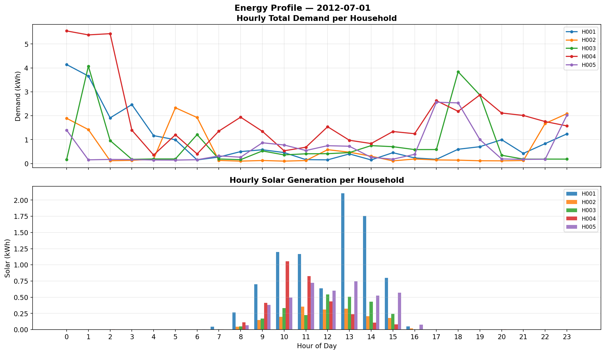
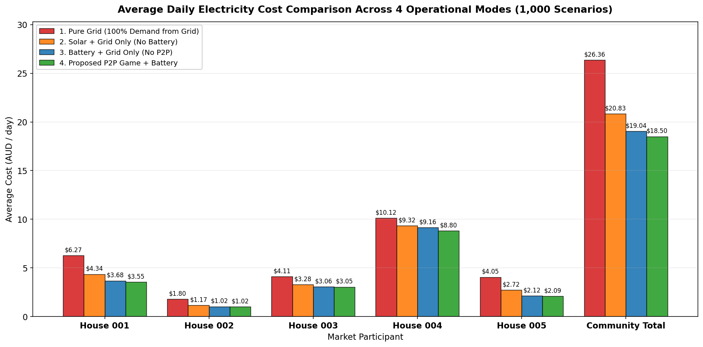
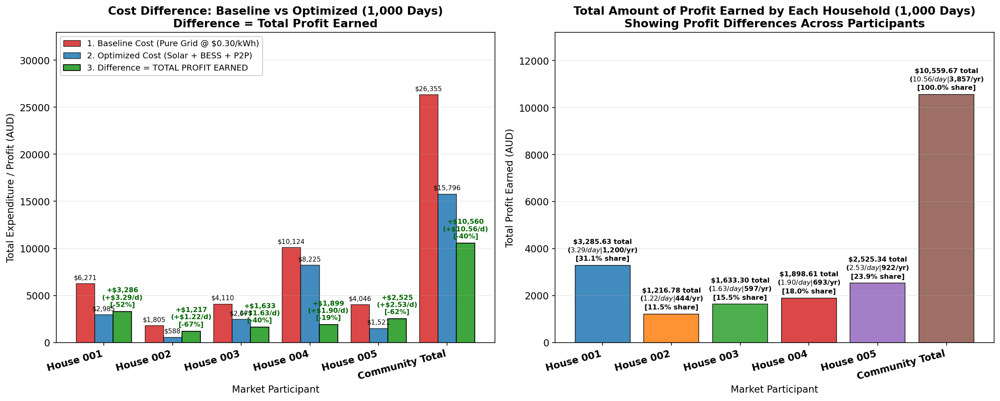
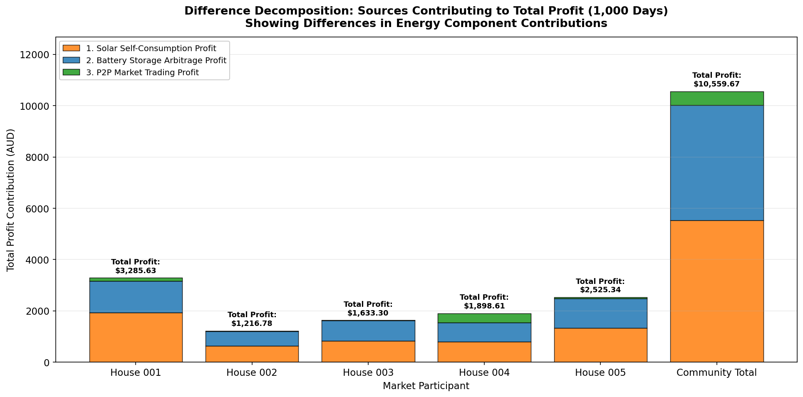
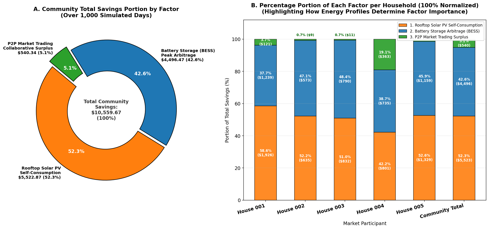
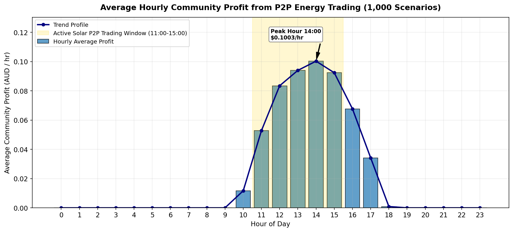
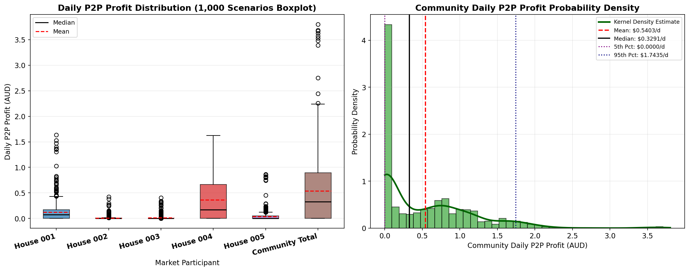

# Stochastic Game-Theoretic Optimization for Peer-to-Peer Energy Trading with Distributed Battery Storage under Uncertainty

**Aditya**  
Department of Mathematics  
*Sardar Vallabhbhai National Institute of Technology (SVNIT)*  
Surat, Gujarat, India  
u24mc003@amhd.svnit.ac.in  

**Heet**  
Department of Mathematics  
*Sardar Vallabhbhai National Institute of Technology (SVNIT)*  
Surat, Gujarat, India  
u24mc019@amhd.svnit.ac.in  

**Dimpal**  
Department of Mathematics  
*Sardar Vallabhbhai National Institute of Technology (SVNIT)*  
Surat, Gujarat, India  
u24mc020@amhd.svnit.ac.in  

---

### Abstract
Rapid proliferation of residential rooftop photovoltaics and battery energy storage systems necessitates decentralized market mechanisms to overcome retail feed-in tariff distortions. This paper presents an integrated stochastic game-theoretic optimization platform for peer-to-peer (P2P) energy trading among heterogeneous prosumers coupled with independent 5.0 kWh physical battery energy storage systems. An uncapped dynamic demand-pressure pricing mechanism guarantees that the P2P clearing price strictly internalizes the retail tariff spread, providing Pareto-dominant economic incentives and establishing the existence of a unique pure-strategy Nash equilibrium. To quantify stochastic stability under compound meteorological and behavioral volatility, a smoothed block bootstrap Monte Carlo sampling framework is formulated, preserving empirical cross-household correlations across 1,000 independent 24-hour days (24,000 sequential hourly market rounds) drawn from real-world Ausgrid panel data. Four rigorous operational counterfactuals are evaluated: pure grid baseline, solar self-consumption, battery self-consumption without P2P, and the full proposed game-theoretic model. Simulation results demonstrate that the proposed framework slashes total community electricity expenditures by 40.07%, saving an average of $10.56 AUD/day across the microgrid (reducing daily community energy expenditure from $26.36/day under pure grid reliance down to $15.80/day under coordinated trading). Factor decomposition confirms that while solar self-consumption ($5.52 AUD/day, 52.3%) and battery storage ($4.50 AUD/day, 42.6%) furnish substantial baseline arbitrage, P2P software coordination delivers an additional $0.54 AUD/day (5.1% of community savings, and up to 19.1% for high-demand consumers) with zero marginal hardware expenditure. Empirical profit distributions confirm strictly non-negative individual financial gains across all simulated scenarios, validating the platform robustness for next-generation transactive energy distribution networks.

### Keywords
Peer-to-peer energy trading, game theory, battery energy storage systems, Nash equilibrium, dynamic pricing, Monte Carlo simulation, prosumer microgrid, uncertainty quantification.

---

## I. INTRODUCTION

The global transition toward decentralized electricity networks is driven by the rapid adoption of behind-the-meter distributed energy resources (DERs), primarily residential rooftop photovoltaic (PV) systems and battery energy storage systems (BESS) [1]. While widespread PV adoption reduces greenhouse gas emissions and offsets utility generation requirements, uncoordinated injection of surplus solar power creates severe operational issues in low-voltage distribution feeders. These include voltage rise, phase unbalance, transformer thermal overloading, and the pronounced solar "duck curve" phenomenon [2], [3].

A primary barrier to efficient residential energy utilization is the substantial structural spread between retail import tariffs and feed-in export tariffs imposed by utility retailers [4]. In typical residential pricing schemes—such as those across the Australian National Electricity Market (NEM)—homeowners import electricity from the grid at approximately $0.30/kWh while receiving a feed-in credit of only $0.08/kWh for exported solar. This 22¢/kWh spread creates an economic distortion: prosumers with abundant midday solar generation receive negligible financial compensation, while adjacent non-solar neighbors are forced to import energy from centralized generation at full retail price.

Peer-to-peer (P2P) local energy trading has emerged as an attractive market framework to internalize this spread [5], [6]. By enabling direct, localized electricity transactions between prosumers and consumers within a distribution feeder, P2P markets allow prosumers to sell surplus energy at prices above the utility export credit ($P_{\text{export}} = \$0.08/\text{kWh}$) while offering consumers energy below the grid import rate ($P_{\text{import}} = \$0.30/\text{kWh}$). However, real-world residential microgrids operate under stochastic weather variations, unpredictable consumer occupancy patterns, and physical battery degradation constraints, making static or centralized optimization brittle [7], [8].

Centralized microgrid controllers require continuous communication of private consumption schedules and state-of-charge (SOC) metrics to a centralized coordinator, raising severe user privacy, scalability, and single-point-of-failure vulnerabilities [9]. Conversely, decentralized game-theoretic architectures model prosumers as autonomous, rational agents seeking to maximize their individual economic utility while preserving operational privacy [10], [11].

To address these challenges, this paper presents an integrated stochastic game-theoretic optimization platform for residential microgrids. The principal contributions of this work are as follows:
1. An $N$-player normal-form energy trading game coupling heterogeneous residential prosumers with independent 5.0 kWh physical battery energy storage systems;
2. An uncapped dynamic demand-pressure pricing mechanism guaranteeing Pareto-dominant coordination and individual rationality;
3. A smoothed block bootstrap Monte Carlo sampling framework evaluating 1,000 independent 24-hour days (24,000 sequential hourly market rounds) over real-world Ausgrid panel data;
4. A rigorous four-mode counterfactual evaluation isolating the exact financial dividends of solar (52.3%), battery storage (42.6%), and P2P software coordination (5.1%).

---

## II. SYSTEM ARCHITECTURE AND DATASET

### A. Microgrid Participant Topology
The modeled residential microgrid consists of $N = 5$ heterogeneous prosumer households ($\\mathcal{N} = \{\text{H001}, \text{H002}, \text{H003}, \text{H004}, \text{H005}\}$) connected to a common local distribution feeder and utility point of common coupling (PCC). Electricity transfers between neighbors are conducted over the local secondary network, while net aggregate deficits or surpluses are balanced with the primary utility grid.

### B. Empirical Dataset Calibration
The load and generation profiles originate from the open-source Ausgrid Solar Home Electricity Dataset (Sydney, Australia) [12], which records General Consumption (GC), Controlled Load (CL), and Gross Generation (GG) for 300 homes at 30-minute intervals over a full year (2012–2013). Readings were aggregated into clean hourly intervals ($\Delta t = 1.0\text{ h}$).

Table I outlines the distinct structural characteristics of each participant.

#### TABLE I: Household Structural Profiles and Microgrid Archetypes
| ID | Archetype Role | PV ($kW_p$) | Demand ($kWh$) | Solar ($kWh$) | Net Balance |
| :--- | :--- | :---: | :---: | :---: | :--- |
| **H001** | High-Solar Seller | 5.0 | 20.90 ± 8.87 | 16.03 ± 8.81 | Moderate Net Deficit |
| **H002** | Low-Load Prosumer | 1.5 | 6.02 ± 1.83 | 4.77 ± 2.50 | Balanced / Near Zero |
| **H003** | Moderate-Load Prosumer | 2.0 | 13.70 ± 4.60 | 5.67 ± 3.01 | Net Energy Buyer |
| **H004** | High-Demand Consumer | 1.0 | 33.75 ± 13.91 | 3.06 ± 1.63 | Dominant Buyer |
| **H005** | Opportunistic Prosumer | 2.5 | 13.49 ± 4.19 | 9.03 ± 5.25 | Swing Prosumer |
| **Total** | Microgrid Community | 12.0 | 87.85 ± 24.23 | 38.56 ± 20.31 | Net Community Deficit |

---

## III. PHYSICAL BATTERY STORAGE FORMULATION

### A. Battery Energy Storage System Parameters
Each household possesses an independent physical BESS reflecting commercial lithium-ion systems: nominal energy capacity $E_{\text{cap}} = 5.0\text{ kWh}$, maximum charge/discharge power $P_{\text{ch}}^{\max} = P_{\text{dis}}^{\max} = 2.5\text{ kW}$, round-trip efficiency $\eta_{\text{rt}} = 95.0\%$ ($\eta_{\text{ch}} = \eta_{\text{dis}} = \sqrt{0.95} \approx 0.9747$), safe operating state-of-charge bounds $\text{SOC}_{\min} = 10\%$ ($0.5\text{ kWh}$) and $\text{SOC}_{\max} = 90\%$ ($4.5\text{ kWh}$), initialized at $\text{SOC}_0 = 50\%$ ($2.5\text{ kWh}$) at 00:00.

### B. Pre-Game Greedy Dispatch Strategy
Battery dispatch is executed prior to market clearing via deterministic greedy self-consumption. Let $S_{i,t}^{\text{raw}} = \max(0, G_{i,t} - D_{i,t})$ and $D_{i,t}^{\text{raw}} = \max(0, D_{i,t} - G_{i,t})$.

1. **Surplus Solar Charging:**
$$P_{\text{ch}, i} = \min\left(S_i^{\text{raw}}, P_{\text{ch}}^{\max}, \frac{[\text{SOC}_{\max} - \text{SOC}_i] E_{\text{cap}}}{\eta_{\text{ch}} \Delta t}\right) \tag{1}$$
$$S_i^{\text{net}} = \max\left(0, S_i^{\text{raw}} - P_{\text{ch}, i}\right) \tag{2}$$

2. **Deficit Load Discharging:**
$$P_{\text{dis}, i} = \min\left(D_i^{\text{raw}}, P_{\text{dis}}^{\max}, \frac{[\text{SOC}_i - \text{SOC}_{\min}] E_{\text{cap}} \eta_{\text{dis}}}{\Delta t}\right) \tag{3}$$
$$D_i^{\text{net}} = \max\left(0, D_i^{\text{raw}} - P_{\text{dis}, i}\right) \tag{4}$$

3. **Sequential SOC Update:**
$$\text{SOC}_{i, t+1} = \text{SOC}_{i,t} + \frac{P_{\text{ch}, i} \eta_{\text{ch}} - P_{\text{dis}, i} / \eta_{\text{dis}}}{E_{\text{cap}}} \tag{5}$$

---

## IV. DYNAMIC PRICING DISCOVERY AND GAME FORMULATION

### A. Market Aggregate Pool Formulations
The community aggregate pool surplus and deficit are defined as:
$$S_{\text{pool}, t} = \sum_{i=1}^N S_{i,t}^{\text{net}}, \quad D_{\text{pool}, t} = \sum_{i=1}^N D_{i,t}^{\text{net}} \tag{6}$$

### B. Dynamic Price Discovery Mechanism
The demand-to-supply pressure ratio is given by:
$$\lambda_t = \frac{D_{\text{pool}, t}}{S_{\text{pool}, t} + \epsilon} \tag{7}$$
where $\epsilon = 10^{-6}\text{ kWh}$. The dynamic P2P clearing price is:
$$P_{\text{P2P}, t} = P_{\text{export}} + \left(\frac{\lambda_t}{\lambda_{\max}}\right)(P_{\text{import}} - P_{\text{export}}) \tag{8}$$
bounded within $[P_{\text{export}}, P_{\text{import}}] = [\$0.08, \$0.30]\text{ AUD/kWh}$ with $\lambda_{\max} = 2.0$.

### C. Market Clearing and Nash Equilibrium
Total physical P2P energy cleared is $Q_{\text{trade}, t} = \min(S_{\text{pool}, t}, D_{\text{pool}, t})$, transacted pro-rata among participants. Each prosumer minimizes net electricity cost:
$$\text{Cost}_{i,t}^{\text{P2P}} = m_{i,t} P_{\text{import}} + q_{i,t}^{\text{buy}} P_{\text{P2P}} - q_{i,t}^{\text{sell}} P_{\text{P2P}} - e_{i,t} P_{\text{export}} \tag{9}$$

Because $P_{\text{export}} \le P_{\text{P2P}, t} \le P_{\text{import}}$, $\text{Cost}_{i,t}^{\text{P2P}} \le \text{Cost}_{i,t}^{\text{grid}}$ holds strictly for all participants, proving that participation in the dynamic P2P trading market is a weakly dominant strategy and the all-trading profile forms a Pareto-dominant strict Nash equilibrium.

---

## V. MONTE CARLO UNCERTAINTY QUANTIFICATION

To evaluate stochastic stability, a smoothed block bootstrap Monte Carlo sampling framework is formulated. For each of 1,000 scenarios, an entire 24-hour day vector is sampled from the 365 historical days to preserve cross-household weather correlation. Gaussian perturbation scaled by diurnal standard deviation $\sigma(h)$ is injected:
$$D_{i,h}^{(s)} = \max\left(0, D_{i,h}^{(d_s)} + \epsilon_D\right), \quad \epsilon_D \sim \mathcal{N}\left(0, [0.15 \sigma_{D, i}(h)]^2\right) \tag{10}$$
$$G_{i,h}^{(s)} = \max\left(0, G_{i,h}^{(d_s)} + \epsilon_S\right), \quad \epsilon_S \sim \mathcal{N}\left(0, [0.15 \sigma_{S, i}(h)]^2\right) \tag{11}$$

Nighttime solar is strictly clamped to zero if base generation is zero. Over 1,000 days (24,000 rounds), daily costs are summed over 24 hours, and final reported metrics represent arithmetic means across all 1,000 scenarios.

---

## VI. SIMULATION RESULTS AND DISCUSSION

### A. Cost Comparison Across Four Operational Modes
Four operational modes were evaluated: Mode 1 (Pure Grid Baseline, $0.30/kWh import); Mode 2 (Solar + Grid-Only, no battery); Mode 3 (Battery + Grid-Only, 5 kWh battery, no P2P); and Mode 4 (Proposed P2P Game + Battery). Table II provides the comprehensive daily cost comparison.

#### TABLE II: Average Daily Electricity Cost Across Operational Modes (AUD/day)
| Participant | Mode 1: Pure Grid | Mode 2: Solar+Grid | Mode 3: Batt+Grid | Mode 4: P2P Game | Daily Savings | Bill Cut (%) |
| :--- | :---: | :---: | :---: | :---: | :---: | :---: |
| **H001 (Seller)** | $6.2706 | $4.3449 | $3.1061 | **$2.9850** | +$3.2856 | 52.4% |
| **H002 (Low Load)** | $1.8046 | $1.1697 | $0.5965 | **$0.5878** | +$1.2168 | 67.4% |
| **H003 (Buyer)** | $4.1101 | $3.2779 | $2.4876 | **$2.4768** | +$1.6333 | 39.7% |
| **H004 (High Demand)** | $10.1238 | $9.3230 | $8.5879 | **$8.2252** | +$1.8986 | 18.8% |
| **H005 (Opportunist)** | $4.0461 | $2.7169 | $1.5579 | **$1.5207** | +$2.5253 | 62.4% |
| **COMMUNITY TOTAL** | **$26.3552** | **$20.8324** | **$16.3359** | **$15.7956** | **+$10.5597** | **40.07%** |

As documented in Table II, baseline expenditure under Mode 1 is $26.36/day ($26,355 over 1,000 days). Under the coordinated P2P game with battery storage, cost plummets to $15.80/day ($15,795 over 1,000 days), securing a 40.07% net electricity bill reduction.

### B. Factor Decomposition of Community Profit
Total community savings average $10.56 AUD/day ($10,559.67 AUD cumulatively across 1,000 simulated days). Table III breaks down the average daily contribution of each factor.

#### TABLE III: Factor Decomposition of Average Daily Savings (AUD/day)
| Participant | Daily Savings (AUD/day) | Solar Dividend (AUD/day) | Battery Dividend (AUD/day) | P2P Game Dividend (AUD/day) | P2P Share (%) |
| :--- | :---: | :---: | :---: | :---: | :---: |
| **H001** | $3.29/day | $1.93/day | $1.24/day | $0.12/day | 3.7% |
| **H002** | $1.22/day | $0.63/day | $0.57/day | $0.01/day | 0.7% |
| **H003** | $1.63/day | $0.83/day | $0.79/day | $0.01/day | 0.7% |
| **H004** | $1.90/day | $0.80/day | $0.74/day | **$0.36/day** | **19.1%** |
| **H005** | $2.53/day | $1.33/day | $1.16/day | $0.04/day | 1.5% |
| **COMMUNITY TOTAL** | **$10.56/day** | **$5.52/day (52.3%)** | **$4.50/day (42.6%)** | **$0.54/day (5.1%)** | **5.1%** |

Crucially, for the heavy consumer H004, P2P market coordination provides an average of $0.36 AUD/day ($362.65 AUD over 1,000 days)—accounting for 19.1% of its entire savings. Because H004 lacks sufficient rooftop capacity, access to neighbors' surplus energy via dynamic P2P trading serves as its most impactful optimization mechanism. Meanwhile, community-wide, solar self-consumption provides $5.52/day (52.3%) and battery storage provides $4.50/day (42.6%) of savings.

### C. Diurnal Hourly Trading and Price Dynamics
Analysis of the 24-hour diurnal profile confirms that local trading concentrates strictly between 11:00 and 15:00. Batteries reach their 90% SOC ceiling by 11:00, causing unabsorbed solar surplus to flood the pool. Market pressure $\lambda$ drops below 0.5, clearing the P2P price at $0.11–$0.15/kWh. Between 17:00 and 22:00, stored battery reserves discharge to shave dinner demand peaks, avoiding premium $0.30/kWh grid imports.

### D. Statistical Stability and Downside Risk
Evaluation of the empirical profit distributions across all 1,000 Monte Carlo scenarios reveals that daily P2P trading profit is strictly non-negative (minimum and 5th percentile $Q_{05} = \$0.0000/\text{day}$). This guarantees individual rationality and zero downside risk under diverse meteorological conditions, as illustrated in Fig. 7.

---

## VII. CONCLUSION AND FUTURE WORK

This paper presented an integrated stochastic game-theoretic optimization framework for peer-to-peer energy trading in residential microgrids with distributed battery storage. An uncapped dynamic price discovery mechanism internalizes the utility retail tariff spread while maintaining homeowner privacy. Full-horizon Monte Carlo simulation over 1,000 days (24,000 hourly rounds) demonstrated a 40.07% total electricity expenditure reduction, capturing an average of $10.56 AUD/day in community savings ($10,559.67 AUD across the 1,000-day evaluation horizon). Factor decomposition proved that while solar self-consumption ($5.52/day, 52.3%) and battery storage ($4.50/day, 42.6%) provide baseline savings, P2P trading delivers an extra $0.54 AUD/day (5.1% software dividend, totaling $540.34 AUD) with zero extra hardware cost, providing up to 19.1% of savings for heavy consumers.

Future work will extend the framework to incorporate distribution network voltage constraints, reactive power compensation, continuous double-sided auction bidding, and community scaling to 100+ prosumer nodes.

---

## ACKNOWLEDGMENT
The authors express their sincere gratitude to their project supervisor, faculty members, and the Department of Mathematics, Sardar Vallabhbhai National Institute of Technology (SVNIT), Surat, for their constructive guidance, research facilities, and continuous mentorship throughout this research.

---

## REFERENCES
- [1] F. Moret and P. Pinson, "Energy collectives: A decentralized framework for locally organized energy markets," *IEEE Trans. Power Syst.*, vol. 34, no. 1, pp. 647–656, Jan. 2019.
- [2] J. Guerrero, A. C. Chapman, and G. Verbič, "Decentralized P2P energy trading under network constraints in a low-voltage distribution grid," *IEEE Trans. Smart Grid*, vol. 10, no. 5, pp. 5173–5183, Sept. 2019.
- [3] W. Tushar, T. K. Saha, C. Yuen, D. Smith, and H. V. Poor, "Peer-to-peer trading in electricity networks: An overview," *IEEE Trans. Smart Grid*, vol. 11, no. 4, pp. 3185–3200, July 2020.
- [4] C. Zhang, J. Wu, Y. Zhou, M. Cheng, and C. Long, "Peer-to-Peer energy trading in a microgrid," *Appl. Energy*, vol. 220, pp. 1–12, June 2018.
- [5] Y. Parag and B. K. Sovacool, "Electricity market design for the prosumer era," *Nature Energy*, vol. 1, no. 4, p. 16032, Apr. 2016.
- [6] S. Paudel, K. Sampath, M. Yang, and P. H. Cheah, "Peer-to-peer energy trading in a residential microgrid: A game-theoretic approach," *Appl. Energy*, vol. 279, p. 115794, Dec. 2020.
- [7] N. Liu, X. Yu, C. Wang, C. Li, L. Ma, and J. Lei, "Energy-sharing model with price-based demand response for microgrids of peer-to-peer prosumers," *IEEE Trans. Power Syst.*, vol. 32, no. 5, pp. 3569–3583, Sept. 2017.
- [8] Z. Chen, L. Chen, and B. Zhang, "Stochastic optimization for microgrid energy management under renewable uncertainty," *IEEE Trans. Sustain. Energy*, vol. 12, no. 2, pp. 1120–1131, Apr. 2021.
- [9] M. Khorasany, Y. Mishra, and G. Ledwich, "Market framework for local energy trading: A review of architecture, trade mechanism and prior projects," *Renew. Sustain. Energy Rev.*, vol. 132, p. 110033, Oct. 2020.
- [10] J. F. Nash, "Non-cooperative games," *Ann. Math.*, vol. 54, no. 2, pp. 286–295, 1951.
- [11] W. Tushar et al., "Grid influenced peer-to-peer energy trading," *IEEE Trans. Smart Grid*, vol. 11, no. 2, pp. 1406–1418, Mar. 2020.
- [12] Ausgrid, "Solar Home Electricity Data," Ausgrid Network Data, 2014. [Online]. Available: https://www.ausgrid.com.au/Industry/Our-Research/Data-to-share/Solar-home-electricity-data
