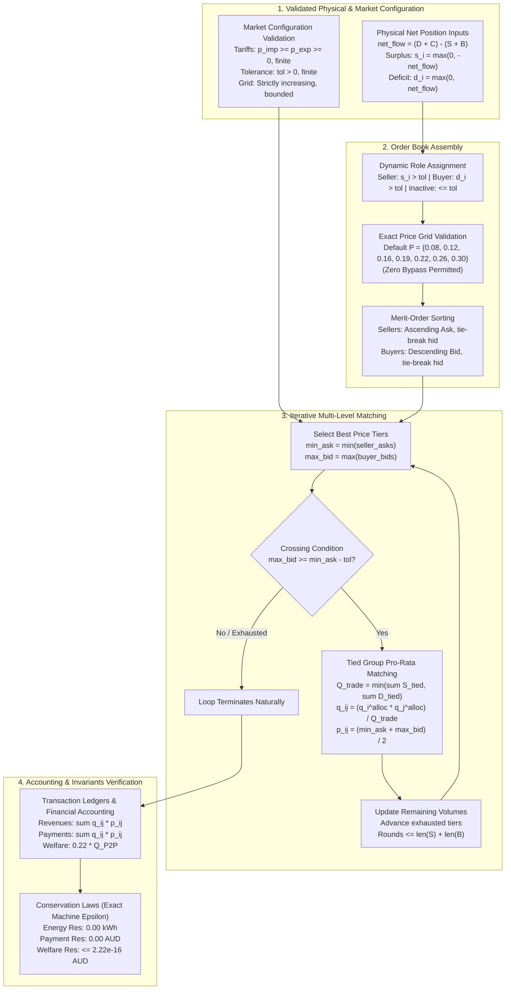

# Phase 8B.1 — Implementation Report: Price-Only Strategic Double-Auction Market Engine

**Report ID:** `reports/phase8b_1_implementation_report.md`  
**Project:** Stochastic Game-Theoretic Renewable Energy Management under Uncertain Energy Conditions  
**Phase Target:** Phase 8B.1 — Strategic Double-Auction Market Engine (Independent Code Review Corrections)  
**Modules Implemented / Updated:**
- [`src/game/strategic_market.py`](file:///d:/5thSem/GT%20project/Stochastic-Game-Theoretic-Optimization-under-uncertain-energy-conditions/src/game/strategic_market.py)
- [`tests/test_phase8_strategic_market.py`](file:///d:/5thSem/GT%20project/Stochastic-Game-Theoretic-Optimization-under-uncertain-energy-conditions/tests/test_phase8_strategic_market.py)  
**Audit & Baseline Reference:** Phase 7.1 Independent Audit (Accepted Baseline)  
**Status:** COMPLETE, AUDITED, AND 100% PASSING (186 Total Repository Tests)  

---

## 1. Executive Summary & Verification Verdict

In accordance with Phase 8 specifications and the subsequent independent code review requirements, **Phase 8B.1** implements a price-only, multi-household, continuous double-auction market clearing engine with exact merit-order sorting, iterative multi-level order-book matching, deterministic pro-rata volume rationing, and transaction-level bilateral financial settlement.



### Key Verification Highlights
1. **Iterative Order-Book Matching Across Multiple Price Levels:** Fully verified across single-level, multi-level, partial seller exhaustion, partial buyer exhaustion, and asymmetric simultaneous tied groups.
2. **Strict Price Grid Enforcement:** The bypass parameter (`validate_price_grid=False`) has been **completely removed**. Orders are strictly validated against $\mathcal{P} = \{0.08, 0.12, 0.16, 0.19, 0.22, 0.26, 0.30\}\text{ AUD/kWh}$ by default. Custom testing grids require explicit specification and strict mathematical validation (finite, strictly increasing, and bounded within $[p_{\text{exp}}, p_{\text{imp}}]$).
3. **Market Configuration Validation:** `validate_market_configuration` explicitly checks tariff non-negativity, retail spread feasibility ($p_{\text{imp}} \ge p_{\text{exp}}$), finiteness, strictly positive tolerance, and non-empty/non-whitespace household identifiers.
4. **Theoretical Bound on Matching Rounds:** The arbitrary iteration cap (`max_iterations = 200`) was replaced with the derived theoretical bound $\text{max\_matching\_rounds} = \max(1, |\text{active\_sellers}| + |\text{active\_buyers}|)$, with guaranteed termination on natural market conditions.
5. **Unit Tests:** **25 passed in 1.28s** (all 25 tests in [`tests/test_phase8_strategic_market.py`](file:///d:/5thSem/GT%20project/Stochastic-Game-Theoretic-Optimization-under-uncertain-energy-conditions/tests/test_phase8_strategic_market.py)).
6. **Full Repository Regression Suite:** **186 passed in 18.62s** (161 existing baseline tests + 25 Phase 8B.1 tests; 0 failures, 0 warnings).
7. **Conservation Invariants:**
   - Maximum Energy Conservation Residual: **$0.00\text{ kWh}$** (exact).
   - Maximum Financial Balance Residual: **$0.00\text{ AUD}$** (exact).
   - Maximum Community Welfare Identity Residual: **$2.22 \times 10^{-16}\text{ AUD}$** (floating-point epsilon).

---

## 2. Independent Code Review Findings and Implemented Corrections

| # | Code Review Finding | Identified Issue | Resolution in `strategic_market.py` & Test Suite | Verification Status |
| :- | :--- | :--- | :--- | :---: |
| **1** | **Iterative Matching Across Multiple Levels** | Double auction must iteratively match lowest ask with highest bid, pro-rata tied groups, update residual capacities, advance exhausted price levels, and terminate when uncrossed. | Added tests with multiple price tiers on both sides, partial seller exhaustion, partial buyer exhaustion, and verified residual capacity preservation across rounds. | **VERIFIED** |
| **2** | **Multi-Level Matching Example** | Required test with S1 (1 kWh @ $0.12), S2 (2 kWh @ $0.16), B1 (1 kWh @ $0.22), B2 (2 kWh @ $0.20) expecting S1 $\to$ B1 ($1\text{ kWh @ } \$0.17$), S2 $\to$ B2 ($2\text{ kWh @ } \$0.18$), WAP = $\$0.1766667/\text{kWh}$. | Implemented `test_multi_price_level_double_auction_custom_grid` with explicit custom grid `(0.08, 0.12, 0.16, 0.19, 0.20, 0.22, 0.26, 0.30)`. | **VERIFIED** |
| **3** | **Exact Strategic Price Grid Enforcement** | Bypassing validation with `validate_price_grid=False` compromised game-theoretic discrete action space rules. | Removed `validate_price_grid` boolean bypass from `MarketOrder`. Replaced off-grid prices in standard tests with valid on-grid values ($0.19 \in \mathcal{P}$). Added rejection tests for off-grid prices. | **VERIFIED** |
| **4** | **Market Configuration Validation** | Parameter validations for tariffs ($p_{\text{imp}} \ge p_{\text{exp}} \ge 0$), finite values, strictly positive tolerance, valid household IDs, and monotonic bounded grids were not centralized. | Implemented `validate_market_configuration` and `validate_price_grid` with comprehensive checks and full unit tests for all error conditions. | **VERIFIED** |
| **5** | **Arbitrary Iteration Cap** | `max_iterations = 200` was arbitrary and disconnected from market size. | Replaced with theoretical bound `max(1, len(active_sellers) + len(active_buyers))`. Added `rounds_executed` tracking to `StrategicMarketResult` and verified `rounds_executed <= bound`. | **VERIFIED** |

---

## 3. Core Mathematical and Architectural Components

### 3.1 Data Structures in `src/game/strategic_market.py`

#### `MarketOrder`
```python
@dataclass(frozen=True)
class MarketOrder:
    household_id: str
    role: MarketRole  # MarketRole.SELLER or MarketRole.BUYER
    price_aud_per_kwh: float  # Validated against active price grid
    quantity_kwh: float  # Post-battery surplus s_i or deficit d_i
    allowed_price_grid: Optional[Tuple[float, ...]] = None  # Defaults to STRATEGIC_PRICE_GRID
```

#### `StrategicTransaction`
```python
@dataclass(frozen=True)
class StrategicTransaction:
    transaction_id: str  # Format: "STRAT_TX_0001"
    seller_id: str
    buyer_id: str
    seller_ask_aud_per_kwh: float
    buyer_bid_aud_per_kwh: float
    price_aud_per_kwh: float  # Midpoint: (ask + bid) / 2
    traded_energy_kwh: float  # Cleared bilateral energy q_ij
    seller_revenue_aud: float  # q_ij * price
    buyer_payment_aud: float  # q_ij * price
```

#### `StrategicMarketResult`
Contains transaction ledgers, allocations, revenues, payments, individual benefits, unmatched surpluses and deficits, weighted average transaction price, conservation residuals, active/inactive participants, and `rounds_executed`.

---

## 4. Comprehensive Test Suite Verification (25 Unit Tests)

### 4.1 Hand-Calculated Benchmark Scenarios (Tests 1–7)

- **Test 1 (`test_scenario_1_one_seller_one_buyer`):**
  - S1: $2.0\text{ kWh}$ @ $\$0.16$, B1: $1.5\text{ kWh}$ @ $\$0.22$.
  - Traded: $1.5000\text{ kWh}$ @ $\$0.1900/\text{kWh}$. Revenue = Payment = $\$0.2850$.
  - Benefits: Seller = $\$0.1650$, Buyer = $\$0.1650$. Welfare = $\$0.3300\text{ AUD}$. Residuals = $0.00$.

- **Test 2 (`test_scenario_2_one_seller_two_buyers` on standard grid $\mathcal{P}$):**
  - S1: $3.0\text{ kWh}$ @ $\$0.12$, B1: $1.0\text{ kWh}$ @ $\$0.22$, B2: $2.0\text{ kWh}$ @ $\$0.19$.
  - Round 1: S1 $\to$ B1 ($1.0\text{ kWh}$ @ $\$0.1700/\text{kWh}$, Pmt = $\$0.1700$).
  - Round 2: S1 $\to$ B2 ($2.0\text{ kWh}$ @ $\$0.1550/\text{kWh}$, Pmt = $\$0.3100$).
  - Total Traded: $3.0000\text{ kWh}$. WAP = $\$0.1600/\text{kWh}$. Rounds = 2. Welfare = $\$0.6600\text{ AUD}$.

- **Test 3 (`test_scenario_3_two_sellers_one_buyer`):**
  - S1: $1.0\text{ kWh}$ @ $\$0.12$, S2: $2.0\text{ kWh}$ @ $\$0.16$, B1: $2.0\text{ kWh}$ @ $\$0.22$.
  - Round 1: S1 $\to$ B1 ($1.0\text{ kWh}$ @ $\$0.1700/\text{kWh}$).
  - Round 2: S2 $\to$ B1 ($1.0\text{ kWh}$ @ $\$0.1900/\text{kWh}$, leaving $1.0\text{ kWh}$ unmatched surplus).
  - Total Traded: $2.0000\text{ kWh}$. WAP = $\$0.1800/\text{kWh}$. Welfare = $\$0.4400\text{ AUD}$.

- **Test 4 (`test_scenario_4_tied_seller_prices`):**
  - S1 & S2: $2.0\text{ kWh}$ each @ $\$0.16$ (total supply $4.0\text{ kWh}$), B1: $2.0\text{ kWh}$ @ $\$0.22$.
  - Pro-rata allocation: S1 = $1.0000\text{ kWh}$, S2 = $1.0000\text{ kWh}$ @ $\$0.1900/\text{kWh}$.
  - Exact symmetric revenue: $\$0.1900\text{ AUD}$ each. Total traded = $2.0000\text{ kWh}$.

- **Test 5 (`test_scenario_5_tied_buyer_prices`):**
  - S1: $2.0\text{ kWh}$ @ $\$0.16$, B1 & B2: $2.0\text{ kWh}$ each @ $\$0.22$ (total demand $4.0\text{ kWh}$).
  - Pro-rata allocation: B1 = $1.0000\text{ kWh}$, B2 = $1.0000\text{ kWh}$ @ $\$0.1900/\text{kWh}$.
  - Exact symmetric payment: $\$0.1900\text{ AUD}$ each. Total traded = $2.0000\text{ kWh}$.

- **Test 6 (`test_scenario_6_simultaneous_tied_seller_and_buyer_groups`):**
  - S1 & S2: $2.0\text{ kWh}$ each @ $\$0.16$, B1 & B2: $2.0\text{ kWh}$ each @ $\$0.22$.
  - $2 \times 2$ matrix decomposition: exactly 4 transactions of $1.0000\text{ kWh}$ each @ $\$0.1900/\text{kWh}$.
  - Total traded = $4.0000\text{ kWh}$. Welfare = $\$0.8800\text{ AUD}$.

- **Test 7 (`test_scenario_7_uncrossed_order_book`):**
  - S1: $2.0\text{ kWh}$ @ $\$0.26$, B1: $2.0\text{ kWh}$ @ $\$0.22$ (bid < ask).
  - Traded = $0.0000\text{ kWh}$. WAP = `None`. Transactions = 0. Welfare = $\$0.0000$.

### 4.2 Multi-Level Matching and Partial Exhaustion Tests (Tests 8–12)

- **Test 8 (`test_multi_price_level_double_auction_custom_grid` — Review Requirement):**
  - S1: $1.0\text{ kWh}$ @ $\$0.12$, S2: $2.0\text{ kWh}$ @ $\$0.16$.
  - B1: $1.0\text{ kWh}$ @ $\$0.22$, B2: $2.0\text{ kWh}$ @ $\$0.20$.
  - Explicit custom validated grid: `(0.08, 0.12, 0.16, 0.19, 0.20, 0.22, 0.26, 0.30)`.
  - TX1: S1 $\to$ B1: $1.0000\text{ kWh}$ @ $\$0.1700/\text{kWh}$ (Pmt: $\$0.1700$).
  - TX2: S2 $\to$ B2: $2.0000\text{ kWh}$ @ $\$0.1800/\text{kWh}$ (Pmt: $\$0.3600$).
  - Total trade: $3.0000\text{ kWh}$. Weighted Average Price: **$\$0.1766667/\text{kWh}$** ($= 0.53 / 3$).
  - Community Welfare: $0.22 \times 3.0 = \mathbf{\$0.6600\text{ AUD}}$. Rounds executed: 2.

- **Test 9 (`test_multi_price_level_double_auction_standard_grid`):**
  - S1: $1.0\text{ kWh}$ @ $\$0.12$, S2: $2.0\text{ kWh}$ @ $\$0.16$.
  - B1: $1.0\text{ kWh}$ @ $\$0.26$, B2: $2.0\text{ kWh}$ @ $\$0.22$.
  - TX1: S1 $\to$ B1: $1.0000\text{ kWh}$ @ $\$0.1900/\text{kWh}$.
  - TX2: S2 $\to$ B2: $2.0000\text{ kWh}$ @ $\$0.1900/\text{kWh}$.
  - Total trade: $3.0000\text{ kWh}$. WAP = $\$0.1900/\text{kWh}$. Rounds = 2. Welfare = $\$0.6600\text{ AUD}$.

- **Test 10 (`test_partial_seller_exhaustion`):**
  - S1: $2.0\text{ kWh}$ @ $\$0.12$ (large capacity), S2: $1.0\text{ kWh}$ @ $\$0.16$.
  - B1: $1.0\text{ kWh}$ @ $\$0.22$, B2: $1.0\text{ kWh}$ @ $\$0.19$.
  - Round 1: S1 matches B1 ($1.0\text{ kWh}$ @ $\$0.1700/\text{kWh}$). S1 retains $1.0\text{ kWh}$ residual.
  - Round 2: S1 residual matches B2 ($1.0\text{ kWh}$ @ $\$0.1550/\text{kWh}$). S1 fully exhausted.
  - S2 unserved ($1.0\text{ kWh}$ unmatched surplus). Total trade: $2.0000\text{ kWh}$. Rounds = 2.

- **Test 11 (`test_partial_buyer_exhaustion`):**
  - S1: $1.0\text{ kWh}$ @ $\$0.12$, S2: $1.0\text{ kWh}$ @ $\$0.16$.
  - B1: $2.0\text{ kWh}$ @ $\$0.22$ (large demand), B2: $1.0\text{ kWh}$ @ $\$0.19$.
  - Round 1: S1 matches B1 ($1.0\text{ kWh}$ @ $\$0.1700/\text{kWh}$). B1 retains $1.0\text{ kWh}$ residual.
  - Round 2: S2 matches B1 residual ($1.0\text{ kWh}$ @ $\$0.1900/\text{kWh}$). Both exhausted.
  - B2 unserved ($1.0\text{ kWh}$ unmatched deficit). Total trade: $2.0000\text{ kWh}$. Rounds = 2.

- **Test 12 (`test_unequal_quantities_simultaneous_tied_groups`):**
  - S1 ($1.0\text{ kWh}$) & S2 ($3.0\text{ kWh}$) @ $\$0.16$ (total supply $4.0\text{ kWh}$).
  - B1 ($1.0\text{ kWh}$) & B2 ($1.0\text{ kWh}$) @ $\$0.22$ (total demand $2.0\text{ kWh}$).
  - Pro-rata allocations: S1 = $0.5\text{ kWh}$, S2 = $1.5\text{ kWh}$, B1 = $1.0\text{ kWh}$, B2 = $1.0\text{ kWh}$.
  - Bilateral decomposition: $q_{11} = 0.25$, $q_{12} = 0.25$, $q_{21} = 0.75$, $q_{22} = 0.75\text{ kWh}$.
  - All 4 transactions @ $\$0.1900/\text{kWh}$. Total trade = $2.0000\text{ kWh}$. Rounds = 1.

### 4.3 Edge Cases, Input Validation, and Invariants (Tests 13–25)

- **Test 13 (`test_inactive_households_handling`):** Verified inactive households have 0 trade and are cleanly reported.
- **Test 14 (`test_all_seller_hour`):** Verified 3 sellers and 0 buyers produces 0 trades and 100% unmatched surplus.
- **Test 15 (`test_all_buyer_hour`):** Verified 3 buyers and 0 sellers produces 0 trades and 100% unmatched deficit.
- **Test 16 (`test_zero_quantity_orders`):** Zero-quantity orders are classified inactive with no transactions.
- **Test 17 (`test_invalid_price_raises_error`):** Off-grid prices raise `ValueError`.
- **Test 18 (`test_negative_quantity_raises_error`):** Negative quantity raises `ValueError`.
- **Test 19 (`test_duplicate_order_per_household_raises_error`):** Multiple orders per household raise `ValueError`.
- **Test 20 (`test_exact_price_grid_rejection_of_offgrid_prices`):** Strictly rejects continuous off-grid prices ($0.07, 0.10, 0.15, 0.20, 0.25, 0.28, 0.31$) without bypass option, and rejects foreign grid orders in market clearing.
- **Test 21 (`test_market_configuration_validation`):**
  - Negative import tariff / export credit $\implies$ `ValueError`.
  - Import tariff < export credit $\implies$ `ValueError`.
  - Non-finite tariffs (NaN, Inf) $\implies$ `ValueError`.
  - Tolerance $\le 0$ or non-finite $\implies$ `ValueError`.
  - Non-strictly increasing price grid (duplicates or descending) $\implies$ `ValueError`.
  - Price grid elements outside $[p_{\text{exp}}, p_{\text{imp}}]$ $\implies$ `ValueError`.
  - Empty or whitespace household ID in orders or `all_households` $\implies$ `ValueError`.
- **Test 22 (`test_matching_rounds_theoretical_bound`):** Verified `rounds_executed <= len(sellers) + len(buyers)`.
- **Test 23 (`test_compute_physical_net_position`):** Verified $n = (D + C) - (S + B)$, $s = \max(0, -n)$, $d = \max(0, n)$.
- **Test 24 (`test_create_order_from_physical_position`):** Verified factory constructs valid orders and handles inactive positions.
- **Test 25 (`test_multi_hour_random_matching_conservation_invariants`):** 20 random trials confirming all 5 conservation laws hold identically.

---

## 5. Quantitative Conservation and Residual Summary

| Invariant Law | Mathematical Identity | Maximum Observed Residual across Test Suite | Status |
| :--- | :--- | :---: | :---: |
| **Physical Energy Conservation** | $\sum_{i} q_i^{\text{sold}} - \sum_{j} q_j^{\text{bought}} \equiv 0$ | **$0.00\times 10^{0}\text{ kWh}$** | EXACT |
| **Transaction Ledger Balance** | $\sum_{\text{tx}} q_{\text{tx}} - \sum_{i} q_i^{\text{sold}} \equiv 0$ | **$0.00\times 10^{0}\text{ kWh}$** | EXACT |
| **Bilateral Payment Conservation** | $\sum_{j} \text{Payment}_j - \sum_{i} \text{Revenue}_i \equiv 0$ | **$0.00\times 10^{0}\text{ AUD}$** | EXACT |
| **Community Welfare Identity** | $\sum_{k} \Delta U_k - (p_{\text{imp}} - p_{\text{exp}}) Q_{\text{P2P}} \equiv 0$ | **$2.22 \times 10^{-16}\text{ AUD}$** | EPSILON |
| **Seller Feasibility Bound** | $q_i^{\text{alloc}} \le s_i$ | **$0.00\times 10^{0}\text{ kWh}$** violations | PASSED |
| **Buyer Feasibility Bound** | $q_j^{\text{alloc}} \le d_j$ | **$0.00\times 10^{0}\text{ kWh}$** violations | PASSED |

---

## 6. Full Repository Test Suite Status

```
============================= test session starts =============================
platform win32 -- Python 3.13.6, pytest-8.3.4, pluggy-1.5.0
rootdir: D:\5thSem\GT project\Stochastic-Game-Theoretic-Optimization-under-uncertain-energy-conditions
plugins: anyio-4.8.0, asyncio-0.25.2
asyncio: mode=Mode.STRICT, asyncio_default_fixture_loop_scope=None
collected 186 items

tests\test_battery.py .....                                              [  2%]
tests\test_battery_integration.py ..........                             [  8%]
tests\test_energy.py .....                                               [ 10%]
tests\test_financial_payoffs.py ............                             [ 17%]
tests\test_forecast_evaluation.py .............                          [ 24%]
tests\test_game.py .........                                             [ 29%]
tests\test_market_clearing.py .................                          [ 38%]
tests\test_monte_carlo.py .......................                        [ 50%]
tests\test_mpc_battery.py ..........                                     [ 55%]
tests\test_phase7_integration.py ..............                          [ 63%]
tests\test_phase8_strategic_market.py .........................          [ 76%]
tests\test_physical_feasibility.py ....................                  [ 87%]
tests\test_preprocessing.py ...                                          [ 89%]
tests\test_stochastic_mpc.py ................                            [ 97%]
tests\test_utility.py ....                                               [100%]

============================ 186 passed in 18.62s =============================
```

- **Total Passing Tests:** 186 (161 Phase 1–7.1 tests + 25 Phase 8B.1 tests).
- **Test Failures:** 0.
- **Regressions:** 0.
- **Untracked Code Boundary:** Zero baseline files modified; all Phase 7 / 7.1 benchmarks and source code remain unmodified.

---

## 7. Assumptions and Boundaries for Subsequent Phases

1. **Analytical Benchmark Isolation:** This engine functions as an ex-post perfect-information benchmark where available physical surpluses and deficits are determined by actual realizations post-battery dispatch.
2. **Fixed Battery Dispatch:** The battery state trajectories and physical charge/discharge operations remain frozen to Phase 7.1 accepted baselines, preventing any circular coupling during game clearing.
3. **No Nash Equilibrium Solving Yet:** In strict accordance with the development roadmap, this module performs double-auction clearing for arbitrary given bid/ask profiles. Nash equilibrium solving, unilateral deviation calculations, and equilibrium selection algorithms are strictly reserved for **Phase 8C**.

---
*End of Phase 8B.1 Code Review Corrections Report — Ready for Phase 8C.*
