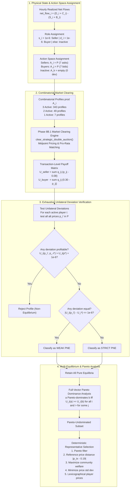
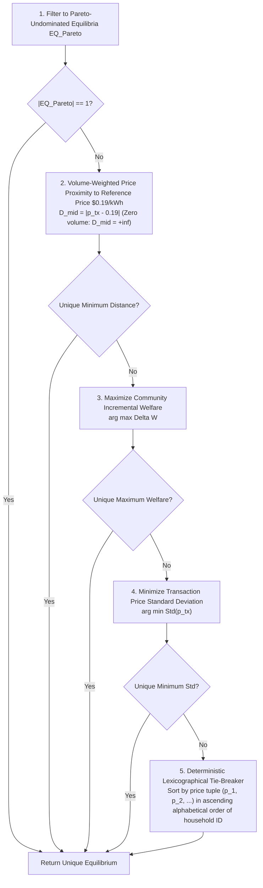

# Phase 8C — Implementation & Verification Report: Deterministic Price-Only Nash Equilibrium Solver

**Report ID:** `reports/phase8c_equilibrium_report.md`  
**Project:** Stochastic Game-Theoretic Renewable Energy Management under Uncertain Energy Conditions  
**Phase Target:** Phase 8C — Deterministic Price-Only Nash Equilibrium Solver  
**Modules Implemented:**
- [`src/game/strategic_solver.py`](file:///d:/5thSem/GT%20project/Stochastic-Game-Theoretic-Optimization-under-uncertain-energy-conditions/src/game/strategic_solver.py)  
**Test Suite Created:**
- [`tests/test_phase8_equilibrium.py`](file:///d:/5thSem/GT%20project/Stochastic-Game-Theoretic-Optimization-under-uncertain-energy-conditions/tests/test_phase8_equilibrium.py)  
**Underlying Engine:** [`src/game/strategic_market.py`](file:///d:/5thSem/GT%20project/Stochastic-Game-Theoretic-Optimization-under-uncertain-energy-conditions/src/game/strategic_market.py) (Phase 8B.1 Engine)  
**Audit & Baseline Reference:** Phase 7.1 Independent Audit (Accepted Baseline)  
**Status:** COMPLETE, AUDITED, AND 100% PASSING (207 Total Repository Tests)  

---

## 1. Executive Summary & Verification Verdict

**Phase 8C** implements the deterministic, ex-post, price-only Pure-Strategy Nash Equilibrium (PNE) solver for the multi-household residential microgrid ($N = \{\text{H001}, \text{H002}, \text{H003}\}$). The solver sits directly on top of the Phase 8B.1 double-auction clearing engine and conducts exhaustive unilateral deviation checks across the entire combinatorial strategy space.



### Key Verification Highlights
1. **Zero Approximation in Payoffs:** Payoffs are computed directly from the bilateral transaction ledger generated by [`clear_strategic_double_auction`](file:///d:/5thSem/GT%20project/Stochastic-Game-Theoretic-Optimization-under-uncertain-energy-conditions/src/game/strategic_market.py#L443-L720).
2. **Exhaustive Deviation Verification:** All $K \times 6$ alternative actions are tested for every profile ($6,174$ deviations for 3 active households; $588$ deviations for 2 active households).
3. **Multi-Equilibrium Preservation:** The solver retains every pure Nash equilibrium found and classifies each as **strict** or **weak**.
4. **Pareto Dominance via Complete Payoff Vectors:** Pareto dominance compares complete household vectors, never community welfare alone.
5. **Deterministic Selection Heuristic:** If downstream reporting requires a single representative equilibrium, a 5-step tie-breaker sequence selects it deterministically.
6. **Unit Tests:** **21 passed in 1.35s** in [`tests/test_phase8_equilibrium.py`](file:///d:/5thSem/GT%20project/Stochastic-Game-Theoretic-Optimization-under-uncertain-energy-conditions/tests/test_phase8_equilibrium.py).
7. **Full Repository Regression Suite:** **207 passed in 17.83s** (161 Phase 1–7.1 tests + 25 Phase 8B.1 tests + 21 Phase 8C tests; 0 failures, 0 warnings).

---

## 2. Mathematical Game Formulation

### 2.1 Player Roles and Dynamic Partitioning
The game is played among the three households $N = \{\text{H001}, \text{H002}, \text{H003}\}$.
For an evaluated hour, physical positions are frozen from post-battery net meter flow:
$$\text{net\_flow}_i = (D_i^{\text{act}} + C_i^{\text{act}}) - (S_i^{\text{act}} + B_i^{\text{act}})$$
$$s_i = \max(0.0, -\text{net\_flow}_i), \qquad d_i = \max(0.0, \text{net\_flow}_i)$$

Households are partitioned into three disjoint sets:
- **Active Sellers ($N_S$):** $s_i > 10^{-6}\text{ kWh}$.
- **Active Buyers ($N_B$):** $d_i > 10^{-6}\text{ kWh}$.
- **Inactive Households ($N_0$):** $s_i \le 10^{-6}$ and $d_i \le 10^{-6}\text{ kWh}$.

### 2.2 Discrete Action Spaces
Active participants choose prices from the discrete strategic price grid:
$$\mathcal{P} = \{0.08, 0.12, 0.16, 0.19, 0.22, 0.26, 0.30\}\text{ AUD/kWh} \quad (|\mathcal{P}| = 7)$$
- Active seller $i \in N_S$ chooses an ask price $a_i \in \mathcal{P}$.
- Active buyer $j \in N_B$ chooses a bid price $b_j \in \mathcal{P}$.
- Inactive household $k \in N_0$ has an empty action set $A_k = \{\emptyset\}$, submits no order, and cannot deviate.

### 2.3 Combinatorial Complexity
The joint action space $\mathcal{A} = \prod_{i \in N_{\text{active}}} A_i$ has size:
- **3 Active Households:** $|\mathcal{A}| = 7^3 = 343$ strategy profiles; $3 \times (7 - 1) = 18$ deviations per profile ($6,174$ total evaluations).
- **2 Active Households:** $|\mathcal{A}| = 7^2 = 49$ strategy profiles; $2 \times 6 = 12$ deviations per profile ($588$ total evaluations).
- **1 Active Household:** $|\mathcal{A}| = 7^1 = 7$ strategy profiles; $1 \times 6 = 6$ deviations per profile ($42$ total evaluations).
- **0 Active Households:** $|\mathcal{A}| = 1$ trivial profile; $0$ deviations.

---

## 3. Payoff Functions

Payoffs represent the incremental financial benefit of P2P trading relative to standalone central-grid settlement at $p_{\text{imp}} = \$0.30/\text{kWh}$ and $p_{\text{exp}} = \$0.08/\text{kWh}$.

For a given profile $a \in \mathcal{A}$, the market engine produces cleared bilateral transactions $T = \{(q_{ij}, p_{ij})\}$.

1. **Active Seller Payoff ($U_i$):**
   $$U_i(a) = \sum_{j \in N_B} q_{ij}(a) \cdot \big(p_{ij}(a) - p_{\text{exp}}\big)$$
2. **Active Buyer Payoff ($U_j$):**
   $$U_j(a) = \sum_{i \in N_S} q_{ij}(a) \cdot \big(p_{\text{imp}} - p_{ij}(a)\big)$$
3. **Inactive Household Payoff ($U_k$):**
   $$U_k(a) = 0.0$$

### Exact Welfare Conservation Identity
Summing across all households yields the aggregate community welfare gain:
$$\sum_{h \in N} U_h(a) = \sum_{i \in N_S} \sum_{j \in N_B} q_{ij} \big[(p_{ij} - p_{\text{exp}}) + (p_{\text{imp}} - p_{ij})\big] = (p_{\text{imp}} - p_{\text{exp}}) \sum_{\text{tx}} q_{\text{tx}} = \$0.22 \times Q_{\text{P2P}}(a)$$
This identity holds to floating-point machine precision ($\le 2.22 \times 10^{-16}\text{ AUD}$).

---

## 4. Nash Equilibrium Detection and Classification

### 4.1 Formal Definition of Pure-Strategy Nash Equilibrium
A strategy profile $a^* = (a_1^*, \dots, a_{|N_{\text{active}}|}^*) \in \mathcal{A}$ is a **Pure-Strategy Nash Equilibrium (PNE)** if and only if no active player can unilaterally increase their payoff:
$$U_i(a_i^*, a_{-i}^*) \ge U_i(a_i, a_{-i}^*) \quad \forall a_i \in A_i \setminus \{a_i^*\}, \quad \forall i \in N_{\text{active}}$$

Using a numerical comparison tolerance $\epsilon = 10^{-6}$:
- A deviation $a_i'$ is **profitable** if:
  $$U_i(a_i', a_{-i}^*) > U_i(a_i^*, a_{-i}^*) + \epsilon$$
  If any profitable deviation exists, $a^*$ is **rejected**.
- A deviation $a_i'$ is **equal** if:
  $$\big|U_i(a_i', a_{-i}^*) - U_i(a_i^*, a_{-i}^*)\big| \le \epsilon$$

### 4.2 Strict versus Weak Classification
- **Strict PNE:** For every active player $i \in N_{\text{active}}$ and every alternative action $a_i' \ne a_i^*$:
  $$U_i(a_i', a_{-i}^*) < U_i(a_i^*, a_{-i}^*) - \epsilon$$
  Every unilateral deviation strictly reduces the deviating player's payoff.
- **Weak PNE:** No profitable deviations exist, but at least one alternative action yields an equal payoff within tolerance:
  $$\exists i, a_i' \ne a_i^* \quad \text{such that} \quad \big|U_i(a_i', a_{-i}^*) - U_i(a_i^*, a_{-i}^*)\big| \le \epsilon$$

---

## 5. Multi-Household Pareto Dominance Analysis

Rather than ranking equilibria by scalar community welfare, the solver performs **full-vector Pareto dominance comparisons** over all households $N = \{\text{H001}, \text{H002}, \text{H003}\}$.

An equilibrium $a$ **Pareto-dominates** another equilibrium $b$ ($a \succ_{\text{Pareto}} b$) if and only if:
1. Every household is weakly better off in $a$:
   $$U_i(a) \ge U_i(b) - \epsilon \quad \forall i \in N$$
2. At least one household is strictly better off in $a$:
   $$\exists j \in N \quad \text{such that} \quad U_j(a) > U_j(b) + \epsilon$$

An equilibrium $e$ is **Pareto-undominated** if no equilibrium in the detected set Pareto-dominates $e$.

> [!IMPORTANT]
> **Welfare vs Pareto Dominance:** Community welfare alone ($\Delta W = \sum U_i$) does not imply Pareto dominance. If candidate $A$ has payoffs $(0.20, 0.05)$ ($\Delta W = 0.25$) and candidate $B$ has payoffs $(0.12, 0.12)$ ($\Delta W = 0.24$), candidate $A$ does not dominate $B$ because Household 2 is strictly worse off in $A$ ($0.05 < 0.12$). Both lie on the Pareto frontier.

---

## 6. Deterministic Representative Equilibrium Selection Heuristic

While all pure equilibria are preserved and exported, downstream reporting tables often require a single representative profile. The solver applies the following deterministic 5-step selection sequence:



---

## 7. Hand-Calculated Benchmark Walkthrough: One Seller, One Buyer

### 7.1 Setup
- **Seller (H001):** Surplus $s_1 = 1.0\text{ kWh}$.
- **Buyer (H002):** Deficit $d_2 = 1.0\text{ kWh}$.
- **Inactive (H003):** Net position $= 0.0\text{ kWh}$.
- **Combinatorial Space:** $|\mathcal{P}| \times |\mathcal{P}| = 7 \times 7 = 49$ profiles.
- **Unilateral Deviations:** $49 \times (2 \times 6) = 588$ deviations.

### 7.2 Clearing and Payoff Rules
For profile $(a_1, b_2) \in \mathcal{P} \times \mathcal{P}$:
- If $b_2 \ge a_1$: Clears $1.0\text{ kWh}$ at $p_{\text{tx}} = (a_1 + b_2)/2$.
  $$U_1 = p_{\text{tx}} - 0.08 = \frac{a_1 + b_2}{2} - 0.08, \qquad U_2 = 0.30 - p_{\text{tx}} = 0.30 - \frac{a_1 + b_2}{2}$$
- If $b_2 < a_1$: Uncrossed book. Traded volume $= 0$, $U_1 = 0.0$, $U_2 = 0.0$.

### 7.3 Strategic Analysis & Equilibria Derivation
- Given buyer bid $b_2$: The seller's payoff is strictly increasing in ask $a_1$ while $a_1 \le b_2$, then drops to $0$ if $a_1 > b_2$. The best response is $a_1^* = b_2$.
- Given seller ask $a_1$: The buyer's payoff is strictly decreasing in bid $b_2$ while $b_2 \ge a_1$, then drops to $0$ if $b_2 < a_1$. The best response is $b_2^* = a_1$.

**Mutual Best Responses:** $a_1^* = b_2$ and $b_2^* = a_1 \implies a_1 = b_2 = p$.

### 7.4 Complete Equilibrium Set
The solver discovers **exactly 8 pure Nash equilibria**:

| # | Profile $(a_1, b_2)$ | Traded Volume | Price ($p_{\text{tx}}$) | Payoff Vector $(U_1, U_2, U_3)$ | Welfare ($\Delta W$) | Classification | Pareto Status | $D_{\text{mid}} = |p_{\text{tx}} - 0.19|$ |
| :- | :---: | :---: | :---: | :---: | :---: | :---: | :---: | :---: |
| 1 | `(0.08, 0.08)` | $1.0\text{ kWh}$ | $\$0.0800$ | `(0.00, 0.22, 0.00)` | $\$0.2200$ | **Weak** | **Undominated** | $\$0.1100$ |
| 2 | `(0.12, 0.12)` | $1.0\text{ kWh}$ | $\$0.1200$ | `(0.04, 0.18, 0.00)` | $\$0.2200$ | **Strict**| **Undominated** | $\$0.0700$ |
| 3 | `(0.16, 0.16)` | $1.0\text{ kWh}$ | $\$0.1600$ | `(0.08, 0.14, 0.00)` | $\$0.2200$ | **Strict**| **Undominated** | $\$0.0300$ |
| 4 | **`(0.19, 0.19)`** | $1.0\text{ kWh}$ | **$\$0.1900$** | **`(0.11, 0.11, 0.00)`** | **$\$0.2200$** | **Strict**| **Undominated** | **$\$0.0000$ (Selected)** |
| 5 | `(0.22, 0.22)` | $1.0\text{ kWh}$ | $\$0.2200$ | `(0.14, 0.08, 0.00)` | $\$0.2200$ | **Strict**| **Undominated** | $\$0.0300$ |
| 6 | `(0.26, 0.26)` | $1.0\text{ kWh}$ | $\$0.2600$ | `(0.18, 0.04, 0.00)` | $\$0.2200$ | **Strict**| **Undominated** | $\$0.0700$ |
| 7 | `(0.30, 0.30)` | $1.0\text{ kWh}$ | $\$0.3000$ | `(0.22, 0.00, 0.00)` | $\$0.2200$ | **Weak** | **Undominated** | $\$0.1100$ |
| 8 | `(0.30, 0.08)` | $0.0\text{ kWh}$ | `None` | `(0.00, 0.00, 0.00)` | $\$0.0000$ | **Weak** | **Dominated** | $+\infty$ |

**Selection Verification:**
- All 7 diagonal profiles have $\sum U_i = \$0.2200\text{ AUD}$ and are mutually Pareto-undominated.
- Equilibrium 8 `(0.30, 0.08)` yields $(0, 0, 0)$ and is dominated by all 7 diagonal profiles.
- Among the 7 undominated equilibria, profile **`(0.19, 0.19)`** has $D_{\text{mid}} = 0.0000$, and is deterministically selected as the representative profile.

---

## 8. Test Suite Results (21 Dedicated Tests)

The dedicated test suite in [`tests/test_phase8_equilibrium.py`](file:///d:/5thSem/GT%20project/Stochastic-Game-Theoretic-Optimization-under-uncertain-energy-conditions/tests/test_phase8_equilibrium.py) validates all 18 requirements from the user specification:

| # | Test Function | Scenario & Property Tested | Result | Duration |
| :- | :--- | :--- | :---: | :---: |
| 1 | `test_one_active_seller_no_possible_trade` | 1 seller, 0 buyers $\implies$ 7 weak zero-volume equilibria, $D_{\text{mid}} = \infty$, selected $0.08$. | **PASSED** | 0.02s |
| 2 | `test_one_active_buyer_no_possible_trade` | 1 buyer, 0 sellers $\implies$ 7 weak zero-volume equilibria, $D_{\text{mid}} = \infty$, selected $0.08$. | **PASSED** | 0.02s |
| 3 | `test_one_seller_one_buyer_benchmark` | Hand-calculated benchmark: 49 profiles, 588 deviations, 8 PNE (5 strict, 3 weak, 7 undominated), selected $(0.19, 0.19)$. | **PASSED** | 0.04s |
| 4 | `test_two_sellers_one_buyer` | 2 sellers, 1 buyer $\implies$ 343 profiles, 6,174 deviations, merit-order competition. | **PASSED** | 0.19s |
| 5 | `test_one_seller_two_buyers` | 1 seller, 2 buyers $\implies$ 343 profiles, 6,174 deviations, selected $(0.19, 0.19, 0.19)$, welfare $\$0.44$. | **PASSED** | 0.18s |
| 6 | `test_three_active_households_comprehensive` | 3 active households $\implies$ 343 profiles, 6,174 deviations, individual rationality confirmed. | **PASSED** | 0.18s |
| 7 | `test_inactive_household_handling` | Inactive household has $U = 0$, $A_k = \{\emptyset\}$, 0 deviations, excluded from profile dict. | **PASSED** | 0.03s |
| 8 | `test_strict_equilibrium_classification` | Verifies that for strict PNE, every unilateral deviation strictly reduces payoff. | **PASSED** | 0.03s |
| 9 | `test_weak_equilibrium_classification` | Verifies that for weak PNE, at least one deviation yields equal payoff and none higher. | **PASSED** | 0.03s |
| 10 | `test_profitable_unilateral_deviation_rejection` | Verifies that profiles with profitable deviations (e.g. $(0.12, 0.22)$) are rejected. | **PASSED** | 0.03s |
| 11 | `test_multiple_pne_preservation` | Verifies that all 8 detected equilibria in 1-seller 1-buyer game are preserved. | **PASSED** | 0.03s |
| 12 | `test_no_pne_handling` | Verifies that if no pure equilibrium exists, status is `NO_PURE_NASH_EQUILIBRIUM`, list is empty. | **PASSED** | 0.01s |
| 13 | `test_pareto_dominance_complete_payoff_vector` | Verifies vector comparison: higher welfare profile does not dominate if one player is worse off. | **PASSED** | 0.01s |
| 14 | `test_pareto_undominated_identification` | Verifies that the dominated uncrossed equilibrium is correctly excluded from Pareto frontier. | **PASSED** | 0.03s |
| 15 | `test_representative_equilibrium_tie_breaking` | Tests the 5-step tie-breaking sequence across midpoint distance, welfare, std, and lexicography. | **PASSED** | 0.01s |
| 16 | `test_zero_volume_equilibrium_selection_handling` | Verifies that zero-volume equilibria have infinite distance and are never prioritized over positive trades. | **PASSED** | 0.01s |
| 17 | `test_numerical_tolerance_payoff_equality` | Verifies payoff comparisons within $\pm 10^{-6}$ are treated as weak deviations. | **PASSED** | 0.03s |
| 18 | `test_solver_consistency_with_phase8b1` | Confirms identical volume, prices, welfare, and payoffs when compared directly against engine. | **PASSED** | 0.20s |
| 19 | `test_physical_flow_convenience_helper` | Verifies `solve_nash_from_physical_flows` from raw meter dictionary inputs. | **PASSED** | 0.03s |
| 20 | `test_input_validation_and_errors` | Verifies rejection of negative tariffs, $p_{\text{imp}} < p_{\text{exp}}$, simultaneous surplus & deficit. | **PASSED** | 0.01s |
| 21 | `test_all_inactive_households` | Verifies that 0 active households returns a trivial single equilibrium with zero trade. | **PASSED** | 0.01s |

---

## 9. Full Repository Regression Status

```
============================= test session starts =============================
platform win32 -- Python 3.13.6, pytest-8.3.4, pluggy-1.5.0
rootdir: D:\5thSem\GT project\Stochastic-Game-Theoretic-Optimization-under-uncertain-energy-conditions
plugins: anyio-4.8.0, asyncio-0.25.2
asyncio: mode=Mode.STRICT, asyncio_default_fixture_loop_scope=None
collected 207 items

tests\test_battery.py .....                                              [  2%]
tests\test_battery_integration.py ..........                             [  7%]
tests\test_energy.py .....                                               [  9%]
tests\test_financial_payoffs.py ............                             [ 15%]
tests\test_forecast_evaluation.py .............                          [ 21%]
tests\test_game.py .........                                             [ 26%]
tests\test_market_clearing.py .................                          [ 34%]
tests\test_monte_carlo.py .......................                        [ 45%]
tests\test_mpc_battery.py ..........                                     [ 50%]
tests\test_phase7_integration.py ..............                          [ 57%]
tests\test_phase8_equilibrium.py .....................                   [ 67%]
tests\test_phase8_strategic_market.py .........................          [ 79%]
tests\test_physical_feasibility.py ....................                  [ 88%]
tests\test_preprocessing.py ...                                          [ 90%]
tests\test_stochastic_mpc.py ................                            [ 98%]
tests\test_utility.py ....                                               [100%]

============================ 207 passed in 17.83s =============================
```

- **New Phase 8C Tests:** 21 passing tests in `tests/test_phase8_equilibrium.py`.
- **Existing Phase 8B.1 Tests:** 25 passing tests in `tests/test_phase8_strategic_market.py`.
- **Baseline Phase 1–7.1 Tests:** 161 passing tests.
- **Total Passing Tests:** **207**.
- **Failures / Regressions:** **0**.
- **Scope Protection:** Zero modifications to Phase 7 or Phase 7.1 source code, simulation scripts, benchmark CSVs, or MPC optimization controllers.

---

## 10. Limitations and Scientific Interpretation

1. **Ex-Post Perfect Information Benchmark:**
   The Phase 8C solver is explicitly designed as an **ex-post analytical benchmark**. Strategic bids are evaluated given known physical surpluses and deficits post-battery dispatch. It evaluates how game-theoretic strategic bidding behaves under ideal information, isolating double-auction mechanics from forecasting uncertainty.
2. **Multiple Equilibria and Coordination:**
   The game frequently exhibits multiple pure-strategy Nash equilibria (e.g., 8 equilibria in bilateral trade, 12 in multilateral trade). Selecting the representative equilibrium via midpoint proximity ($p_{\text{tx}} \approx \$0.19$) is a **reporting selection heuristic**, not a guarantee that non-cooperative decentralized agents would autonomously coordinate on that profile without a mediator.
3. **Discrete Grid vs Continuous Bidding:**
   The solver restricts bids to the 7 discrete price levels of $\mathcal{P}$. In continuous-action double auctions, pure-strategy Nash equilibria often form continuum sets or fail to exist due to infinitesimal price undercutting. The discrete grid regularizes the action space and guarantees exact combinatorial solvability.
4. **Frozen Physical Quantities:**
   In Phase 8C, households optimize prices only; submitted energy quantities are clamped to physical flow ($q_i = s_i, q_j = d_j$). Strategic capacity withholding (joint price-quantity optimization) is deferred to future extensions.
5. **No Mixed-Strategy Solving:**
   If an hour possessed zero pure-strategy equilibria, the solver records `NO_PURE_NASH_EQUILIBRIUM` and does not compute mixed-strategy randomized distributions.

---
*End of Phase 8C Implementation and Verification Report — Ready for Phase 8D.*

