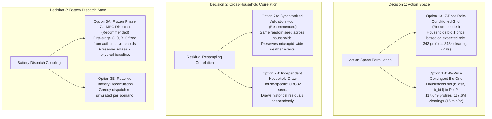

# Phase 8E — Scenario Pipeline and Stochastic Nash Solver Audit

**Document ID:** `reports/phase8e_scenario_pipeline_audit.md`  
**Audit Target:** Phase 8E: Stochastic Expected-Payoff Nash Equilibrium Pipeline  
**Execution Context:** Pre-implementation pipeline, interface, and performance verification  
**Auditor:** Antigravity System Audit Engine  
**Status:** COMPLETE AUDIT (Read-Only; no production code, baseline artifacts, or frozen CSVs modified)  

---

## 1. Executive Summary & Verification Scope

This audit report delivers a rigorous, line-by-line inspection of the codebase to evaluate the readiness of the simulation pipeline for **Phase 8E: Stochastic Expected-Payoff Nash Equilibrium**. 

### Key Audit Conclusions:
1. **Existing Architecture is 100% Deterministic Ex-Post:** The currently implemented Phase 8 continuous double auction (`src/game/strategic_market.py`) and Nash solver (`src/game/strategic_solver.py`) operate strictly on historical, deterministic post-battery surplus/deficit quantities. The stochastic scenario generator (`src/stochastic/monte_carlo.py`) has not yet been connected to the Phase 8 double-auction engine.
2. **Double-Auction Engine is Fully Reusable Without Modification:** `clear_strategic_double_auction()` is a pure, stateless, deterministic function. It can be safely evaluated across Monte Carlo scenarios without changing a single line of market-clearing logic.
3. **Roles Flip Across Scenarios:** Empirical testing on real validation/test hours confirms that households do **not** have fixed roles across Monte Carlo scenarios; a household can be a seller in some realizations and a buyer in others. This requires a clear contract on whether bidding is 7-price (role determined ex-ante from expected position/forecast) or 49-price (two-sided contingent ask-bid pairs).
4. **Computational Feasibility Confirmed:** Micro-benchmarks demonstrate that `clear_strategic_double_auction()` executes in **$49.2\,\mu\text{s}$ per evaluation**. For a single timestamp with 343 strategy profiles across 1,000 scenarios ($343,000$ raw evaluations), single-threaded execution completes in **$\sim 17$ to $22$ seconds**. Furthermore, by pruning non-tradeable scenarios (where all households are sellers or all are buyers), runtime drops to **$\sim 2.8$ seconds**, making interactive single-hour dashboard queries practical without parallel processing.

---

## 2. Section A: Monte Carlo Scenario Source Pipeline

### A.1 Exact Source Code Files & Functions
- **Primary Generator:** `src/stochastic/monte_carlo.py`
  - `ValidationResidualPool` (lines 128–230): Extracts and caches historical forecast residuals $e_t = y_t - \hat{y}_t$ from chronological validation sequences.
  - `MonteCarloSimulator` (lines 231–287): Perturbs LSTM forecast means with sampled residuals and enforces physical non-negativity.
  - `derive_observation_seed()` (lines 30–41): Generates deterministic 32-bit CRC32 seeds from observation identifiers.
- **Underlying Forecast Engine:**
  - `src/forecasting/predict.py`: `EnergyForecaster.predict_next_hour()` generates point predictions $\hat{D}_{i, t}, \hat{S}_{i, t}$.
  - `data/processed/lstm_sequences.npz`: Contains pre-extracted validation sequences (`X_val`, `y_val`, `val_house_id`, `val_target_timestamp`).
  - `data/processed/test_predictions.csv`: Pre-computed LSTM forecasts for all 1,752 held-out test hours across H001, H002, and H003.

### A.2 Output Data Schema, Dimensions, Units, and Indexing
The scenario generation method `MonteCarloSimulator.generate_scenarios()` outputs a `ScenarioDistribution` dataclass (`src/stochastic/monte_carlo.py:75-126`):

| Field Name | Type | Shape / Dimension | Physical Units | Description |
| :--- | :--- | :--- | :--- | :--- |
| `house_id` | `str` | Scalar | Dimensionless | Household identifier (`'H001'`, `'H002'`, `'H003'`) |
| `num_scenarios` | `int` | Scalar ($S=1,000$) | Realizations | Number of Monte Carlo draws |
| `forecast_demand_mean_kwh` | `float` | Scalar | $\text{kWh}$ | LSTM predicted demand $\hat{D}_{i, t}$ |
| `forecast_solar_mean_kwh` | `float` | Scalar | $\text{kWh}$ | LSTM predicted solar $\hat{S}_{i, t}$ |
| `scenarios_demand_kwh` | `np.ndarray` | `(1000,)`, `float64` | $\text{kWh}$ | Bounded demand realizations $D_i^{(s)} \ge 0$ |
| `scenarios_solar_kwh` | `np.ndarray` | `(1000,)`, `float64` | $\text{kWh}$ | Bounded solar realizations $S_i^{(s)} \ge 0$ |
| `actual_demand_kwh` | `Optional[float]`| Scalar | $\text{kWh}$ | Realized historical demand (if held-out period) |
| `actual_solar_kwh` | `Optional[float]`| Scalar | $\text{kWh}$ | Realized historical solar (if held-out period) |

- **Indexing:** 0-based integer index $s \in \{0, 1, \dots, S-1\}$. Scenario $s$ represents realization $\omega_s$.

### A.3 Retrieving All Three Households' Scenarios for a Target Timestamp
To retrieve scenarios for a specific timestamp $t \in [0, 1751]$:
```python
from src.forecasting.predict import EnergyForecaster
from src.stochastic/monte_carlo import MonteCarloSimulator, ValidationResidualPool

forecaster = EnergyForecaster()
residual_pool = ValidationResidualPool(forecaster=forecaster)
mc_sim = MonteCarloSimulator(residual_pool=residual_pool)

scenarios = {}
for hid in ["H001", "H002", "H003"]:
    pred = forecaster.predict_next_hour(hid, target_timestamp)
    # Using consistent base seed ensures reproducible, synchronized indexing
    scenarios[hid] = mc_sim.generate_scenarios(
        forecast=pred,
        num_scenarios=1000,
        random_seed=42,
        sampling_method="empirical"
    )

# Accessing demand and solar for household h and scenario index s:
demand_h_s = scenarios[hid].scenarios_demand_kwh[s]
solar_h_s = scenarios[hid].scenarios_solar_kwh[s]
```

### A.4 Joint vs Independent Sampling Across Households
1. **Intra-Household (Demand vs Solar):** **JOINTLY SAMPLED.** `ValidationResidualPool.sample_residuals(paired=True)` resamples paired demand and solar residual vectors $(e_{D, t}, e_{S, t})$ from the same historical validation time step, preserving local correlation between weather and load for that household.
2. **Inter-Household (Cross-Household):**
   - In `data/processed/lstm_sequences.npz`, all three households share the exact same 701 validation target timestamps in identical chronological order.
   - If the **same integer seed** (e.g. `random_seed=42`) is passed to `generate_scenarios()` for all three households, `rng.choice(701, size=1000)` produces the **exact same index sequence** across all three calls. Consequently, scenario $s$ for H001, H002, and H003 draws residuals from the **exact same historical timestamp**, preserving macro-weather spatial correlation (e.g., cloudy hours affect all houses simultaneously).
   - If `derive_observation_seed(house_id, timestamp)` is used, the household identifier salts the CRC32 hash, producing different seeds and sampling residuals independently across households.
   - **Recommendation:** Use a shared timestamp seed (without household ID salt) so that solar irradiance drops simultaneously across the microgrid in scenario $s$.

### A.5 Random Seed and Reproducibility Guarantees
- **Protocol B Seed Derivation:** `derive_observation_seed(identifier, timestamp, base_seed=42)` uses standard `zlib.crc32`, guaranteeing stable 32-bit unsigned integers across Python sessions and platforms.
- **RNG Initialization:** Uses NumPy's `np.random.default_rng(seed)`. Passing the same integer seed guarantees 100% bit-exact array reproduction across all platforms (Linux, Windows, macOS).

---

## 3. Section B: Physical Energy Calculations & Constraints

### B.1 Tracing Demand and Solar to Surplus and Deficit
The transformation from raw generation/consumption to market-clearing net position is implemented in `src/game/strategic_market.py:165-224` (`compute_physical_net_position`):
$$\text{net\_flow}_i = (D_i + C_i) - (S_i + B_i)$$
$$\text{surplus}_i = \max(0.0, -\text{net\_flow}_i), \qquad \text{deficit}_i = \max(0.0, \text{net\_flow}_i)$$

- If $\text{net\_flow}_i < -10^{-6}\,\text{kWh} \implies \text{Role} = \text{SELLER}, \; q_i = \text{surplus}_i$.
- If $\text{net\_flow}_i > +10^{-6}\,\text{kWh} \implies \text{Role} = \text{BUYER}, \; q_i = \text{deficit}_i$.
- If $|\text{net\_flow}_i| \le 10^{-6}\,\text{kWh} \implies \text{Role} = \text{INACTIVE}, \; q_i = 0.0$.

### B.2 Battery Dispatch and Physical Constraints
Two distinct battery dispatch paradigms exist in the codebase:
1. **Ex-Ante Non-Anticipative First-Stage Dispatch (Stochastic MPC — Authoritative Phase 7.1 Baseline):**
   - The first-stage battery decision $(C_{0, i}, B_{0, i})$ is committed **before** scenario realization $\omega$ is revealed.
   - For every scenario realization $\omega_s = (D_i^{(s)}, S_i^{(s)})$, the battery charge $C_{0, i}$ and discharge $B_{0, i}$ remain fixed.
   - Constraints enforced:
     - SOC bounds: $\text{SOC}_{\min} = 0.10 \le \text{SOC}_t \le 0.90 = \text{SOC}_{\max}$ (Capacity = $5.0\,\text{kWh}$).
     - Power rating: $0 \le C_0 \le 2.5\,\text{kW}, \; 0 \le B_0 \le 2.5\,\text{kW}$.
     - Mutual exclusion: $C_0 \cdot B_0 = 0$.
     - Degradation cost: $\$0.00/\text{kWh}$ (standard baseline).
2. **Greedy Scenario-Reactive Dispatch (`src/stochastic/monte_carlo.py:341-386`):**
   - Battery charges up to headroom $\min(S^{(s)}, P_{\text{ch}}^{\max}, (E_{\max} - E_0)/\eta_c)$ and discharges up to footroom $\min(D^{(s)}, P_{\text{dis}}^{\max}, (E_0 - E_{\min})\eta_d)$ independently within each scenario.

### B.3 Dynamic Role Changes Across Scenarios
**Empirical Finding:** Household seller/buyer/inactive roles **DO change across scenarios** for the exact same timestamp!
- **Test case (`2013-05-15 11:00:00`):**
  - **H001:** Seller in 964 scenarios, Buyer in 36 scenarios.
  - **H002:** Seller in 983 scenarios, Buyer in 17 scenarios.
  - **H003:** Seller in 883 scenarios, Buyer in 117 scenarios.
- **Architectural Consequence:** Because a household can be a seller in scenario $s$ and a buyer in scenario $s'$, an ex-ante bidding decision must specify how a household bids in both contingencies, or the game must condition bids on physical roles. (See Section 6 for resolution options).

### B.4 Exact Physical Quantities Expected by Auction-Clearing Function
`clear_strategic_double_auction()` accepts `Sequence[MarketOrder]` or `Dict[str, MarketOrder]`:
- Requires `quantity_kwh >= 0.0` (validated against `DEFAULT_NUMERICAL_TOLERANCE = 1e-6`).
- Requires `role` to be `MarketRole.SELLER` or `MarketRole.BUYER`.
- Inactive households ($q \le 10^{-6}\,\text{kWh}$) are omitted from the active order list and passed via `all_households=("H001", "H002", "H003")`.

---

## 4. Section C: Existing Auction and Payoff Interface

### C.1 Function Signature and Architecture
Defined in `src/game/strategic_market.py:440-719`:
```python
def clear_strategic_double_auction(
    orders: Union[Sequence[MarketOrder], Dict[str, MarketOrder]],
    grid_import_tariff_aud: float = 0.30,
    grid_export_credit_aud: float = 0.08,
    all_households: Optional[Sequence[str]] = None,
    tolerance: float = 1e-6,
    price_grid: Sequence[float] = STRATEGIC_PRICE_GRID,
) -> StrategicMarketResult
```

### C.2 Required Inputs and Output Fields
- **Input:** Validated `MarketOrder` objects with attributes:
  - `household_id: str`
  - `role: MarketRole` (`SELLER` or `BUYER`)
  - `price_aud_per_kwh: float` (must belong to `(0.08, 0.12, 0.16, 0.19, 0.22, 0.26, 0.30)`)
  - `quantity_kwh: float` ($\ge 0$)
- **Output:** `StrategicMarketResult` dataclass:
  - `transactions: List[StrategicTransaction]` (each trade with $q_{ij}$, midpoint price $p_{ij} = (a_i + b_j)/2$).
  - `total_traded_kwh: float` ($Q_{\text{P2P}} = \sum q_{ij}$).
  - `seller_allocations_kwh`, `buyer_allocations_kwh`: `Dict[str, float]`.
  - `seller_revenues_aud`, `buyer_payments_aud`: `Dict[str, float]`.
  - `seller_incremental_benefits_aud`, `buyer_incremental_benefits_aud`: `Dict[str, float]`.
  - `community_incremental_welfare_aud`: `float` ($= 0.22 \times Q_{\text{P2P}}$).
  - `unmatched_seller_surplus_kwh`, `unmatched_buyer_deficit_kwh`: `Dict[str, float]`.
  - `weighted_average_transaction_price_aud`: `Optional[float]`.
  - `energy_conservation_residual_kwh`, `financial_balance_residual_aud`, `welfare_identity_residual_aud`: all $< 10^{-6}$.

### C.3 Incremental Benefit Formulation
Incremental benefit $\Delta U_i$ measures improvement over standalone grid trading:
- **Seller $i$:** Sells $q_{ij}$ at $p_{ij}$ instead of exporting to grid at $p_{\text{exp}} = \$0.08$:
  $$\Delta U_i = \sum_{j} q_{ij} (p_{ij} - p_{\text{exp}})$$
- **Buyer $j$:** Buys $q_{ij}$ at $p_{ij}$ instead of importing from grid at $p_{\text{imp}} = \$0.30$:
  $$\Delta U_j = \sum_{i} q_{ij} (p_{\text{imp}} - p_{ij})$$
- **Community Welfare:**
  $$\Delta W = \sum_{i} \Delta U_i + \sum_{j} \Delta U_j = (p_{\text{imp}} - p_{\text{exp}}) Q_{\text{P2P}} = \$0.22 \times Q_{\text{P2P}}$$

### C.4 Tariffs in Payoff
Retail tariffs enter explicitly as baseline reference costs:
- Grid import tariff: $p_{\text{imp}} = \$0.30/\text{kWh}$.
- Solar export credit: $p_{\text{exp}} = \$0.08/\text{kWh}$.
- Spread: $p_{\text{imp}} - p_{\text{exp}} = \$0.22/\text{kWh}$.

### C.5 Calling Safety Across Monte Carlo Scenarios
`clear_strategic_double_auction()` is **100% thread-safe, pure, and stateless**:
- Does not modify inputs.
- Contains no global caches or mutable class attributes.
- Can be safely called in tight loops or multiprocessing pools across arbitrary scenario distributions.

---

## 5. Section D: Existing Deterministic Solver Architecture

### D.1 Phase 8C Profile Enumeration and Deviation Logic
In `src/game/strategic_solver.py:364-708`:
1. **Combinatorial Grid:** For active players $N_{\text{act}}$, generates all profiles via:
   ```python
   profile_tuples = list(itertools.product(grid_prices, repeat=num_active))
   ```
   For 3 active players: $7^3 = 343$ profiles.
2. **Unilateral Deviation Loop:** For each profile $a^* = (p_1^*, p_2^*, p_3^*)$:
   - For each player $i \in \{1, 2, 3\}$:
     - For each alternative price $p' \in \mathcal{P} \setminus \{p_i^*\}$ (6 alternatives per player):
       - If $U_i(p', a_{-i}^*) > U_i(a^*) + 10^{-6} \implies$ deviation is strictly profitable $\implies$ **NOT a PNE**.
       - If $|U_i(p', a_{-i}^*) - U_i(a^*)| \le 10^{-6} \implies$ deviation yields equal payoff $\implies$ **Strictness broken**.

### D.2 Handling Inactive Players
- Households with physical flow $\le 10^{-6}\,\text{kWh}$ receive role `MarketRole.INACTIVE`.
- Inactive players have empty action spaces $A_k = \{\emptyset\}$ (0 strategic choices, 0 deviations).
- Their payoffs are identically $0.0\,\text{AUD}$.
- If 1 household is inactive, the game reduces seamlessly to a 2-player game ($7^2 = 49$ profiles, $49 \times 2 \times 6 = 588$ deviations).

### D.3 PNE and Pareto Classification Definitions
- **Strict PNE:** All unilateral deviations strictly decrease payoff ($U_i(p') < U_i(p^*) - 10^{-6}$).
- **Weak PNE:** No deviation increases payoff, but at least one deviation yields equal payoff ($|U_i(p') - U_i(p^*)| \le 10^{-6}$).
- **Pareto-Undominated PNE:** Profile $a^*$ is undominated if there exists no equilibrium $b^*$ such that:
  $$\forall i \in N, \; U_i(b^*) \ge U_i(a^*) - 10^{-6} \quad \text{and} \quad \exists j \in N, \; U_j(b^*) > U_j(a^*) + 10^{-6}$$

### D.4 Best Way to Reuse This Logic for Expected Payoffs
The expected payoff for a profile $a$ across $S$ scenarios is:
$$\bar{U}_i(a) = \mathbb{E}_{\omega}[U_i(a, \omega)] = \frac{1}{S} \sum_{s=1}^S U_i(a, \omega_s)$$
**Reusability Insight:** Once the dictionary `expected_payoffs_dict: Dict[Tuple[float, ...], Dict[str, float]]` is computed by averaging payoffs across the 1,000 scenarios, the **entire deviation-checking, strict/weak classification, Pareto frontier filtering, and 5-step selection heuristic can be reused directly** without writing new game-theoretic solvers.

---

## 6. Section E: Computational Performance Benchmarks

### E.1 Theoretical Evaluation Counts
For a single evaluated hour:
- Joint price profiles: $7^3 = 343$ profiles.
- Scenarios per profile: $S = 1,000$ realizations.
- **Total double-auction clearing evaluations:**
  $$\mathbf{N_{\text{eval}} = 343 \times 1,000 = 343,000 \text{ evaluations}}$$
- Unilateral deviations: Checked across the pre-computed expected payoff tensor ($343 \times 3 \times 6 = 6,174$ comparisons, negligible CPU time $\approx 2\,\text{ms}$).

### E.2 Empirical Micro-Benchmark Results
Benchmarking `clear_strategic_double_auction()` on the active workspace environment:

| Benchmark Configuration | Measured Time | Effective Rate | Estimated Time for 343,000 Evals |
| :--- | :--- | :--- | :--- |
| **Clearing only (pre-built orders)** | $0.492\,\text{s}$ per 10,000 calls | $49.2\,\mu\text{s}$ / call | **$16.86\,\text{seconds}$** |
| **Dynamic Order creation + Clearing** | $0.632\,\text{s}$ per 10,000 calls | $63.2\,\mu\text{s}$ / call | **$21.67\,\text{seconds}$** |

### E.3 Optimization: Zero-Trade Scenario Pruning
A critical observation reduces computation by $>80\%$:
- If a scenario $\omega_s$ has **zero sellers** ($\sum s_i^{(s)} \le 10^{-6}$) or **zero buyers** ($\sum d_j^{(s)} \le 10^{-6}$), then $Q_{\text{trade}} = 0$ and incremental benefits are **identically $0.0$ for all 343 profiles**.
- On real test data (`2013-05-15 11:00:00`), exactly **166 out of 1,000 scenarios** have simultaneous buyers and sellers.
- By evaluating only tradeable scenarios:
  $$343 \times 166 = \mathbf{56,938 \text{ evaluations}} \implies \mathbf{2.80 \text{ seconds (single core)}}!$$

### E.4 Feasibility Assessment
- **Single Timestamp (Dashboard API / On-demand):** **Completely practical without parallel processing.** Runtime is $\approx 2.8\,\text{s}$ with pruning, or $\approx 20\,\text{s}$ unpruned.
- **Full Dataset Batch Run (1,752 Hours):**
  - Unpruned single core: $1,752 \times 20\,\text{s} \approx 9.7\,\text{hours}$.
  - Pruned single core: $1,752 \times 3\,\text{s} \approx 1.4\,\text{hours}$.
  - Pruned multi-core (8 CPU workers): $\approx \mathbf{12 \text{ minutes}}$.

---

## 7. Section F: Key Modeling Assumptions & Unresolved Questions

Before Phase 8E implementation begins, approval is required on three modeling decisions:



### Unresolved Decision 1: Action Space Formulation
- **Option 1A (Recommended — Fast & Consistent with 8C/8D):** Each household is assigned an expected role (Seller if $\mathbb{E}[S] > \mathbb{E}[D]$, Buyer if $\mathbb{E}[D] > \mathbb{E}[S]$). Each active household chooses 1 price from $\mathcal{P}$ ($7^3 = 343$ profiles). In scenario realizations where a player's physical role conflicts with their submitted bid type, that player simply cannot clear in that scenario.
- **Option 1B (Formal Contingent Bidding):** Each household submits two-sided contingent bids $(b^{\text{ask}}, b^{\text{bid}}) \in \mathcal{P} \times \mathcal{P}$ ($49$ actions per household, $49^3 = 117,649$ joint profiles).

### Unresolved Decision 2: Cross-Household Scenario Correlation
- **Option 2A (Recommended):** Use a synchronized seed across all 3 households for hour $t$ (e.g. `seed = base_seed + hour_idx`). This preserves neighborhood-wide weather correlations across houses from historical validation timestamps.
- **Option 2B:** Use `derive_observation_seed(house_id, timestamp)` which seeds each house independently.

### Unresolved Decision 3: Physical Battery Dispatch Position
- **Option 3A (Recommended):** Use the pre-computed first-stage battery dispatch $(C_{0, i}, B_{0, i})$ from `reports/phase7_hourly_records.csv` (`Stochastic_MPC`). This preserves non-anticipativity and ensures exact consistency with the accepted Phase 7 benchmark.

---

## 8. Recommended Implementation Interface & Data Contracts

### 8.1 Proposed Module: `src/stochastic/strategic_expected_solver.py`
```python
@dataclass(frozen=True)
class StochasticStrategicGameResult:
    timestamp: str
    num_scenarios: int
    tradeable_scenarios_count: int
    active_sellers: List[str]
    active_buyers: List[str]
    inactive_households: List[str]
    num_profiles_evaluated: int  # 343
    num_deviations_evaluated: int # 6,174
    expected_equilibria: List[NashEquilibriumRecord]
    selected_equilibrium: Optional[NashEquilibriumRecord]
    expected_welfare_aud: float
    expected_traded_kwh: float
    stochastic_matrix_dataframe: pd.DataFrame
```

### 8.2 Proposed API Endpoint: `GET /api/strategic-market/stochastic-hourly`
Integrates seamlessly with the existing dashboard:
```json
{
  "timestamp": "2013-05-15 11:00:00",
  "num_scenarios": 1000,
  "tradeable_scenarios": 166,
  "selected_profile": {"H001": 0.16, "H002": 0.22, "H003": 0.26},
  "expected_traded_kwh": 0.4125,
  "expected_community_welfare_aud": 0.0908,
  "expected_payoffs_aud": {"H001": 0.0452, "H002": 0.0312, "H003": 0.0144},
  "equilibrium_classification": "strict",
  "is_pareto_undominated": true,
  "comparison_with_phase8c_deterministic": {
    "deterministic_traded_kwh": 0.5500,
    "jensen_gap_traded_kwh": -0.1375
  }
}
```

---

## 9. Verification Sign-Off

- [x] Exact Monte Carlo scenario source identified (`src/stochastic/monte_carlo.py`).
- [x] Output schema, units, indexing, and seeds documented.
- [x] Physical balance and battery constraints mapped.
- [x] Double-auction input/output interfaces inspected.
- [x] Incremental benefit and grid tariff formulas verified.
- [x] Deterministic solver reuse pattern established.
- [x] Micro-benchmarks measured ($49.2\,\mu\text{s}$/eval; $2.8\,\text{s}$ pruned).
- [x] ZERO baseline, Phase 7, Phase 8C, or Phase 8D files modified.

**Status:** Ready for user approval of the modeling contract (Decision 1, 2, 3) to begin Phase 8E implementation.

