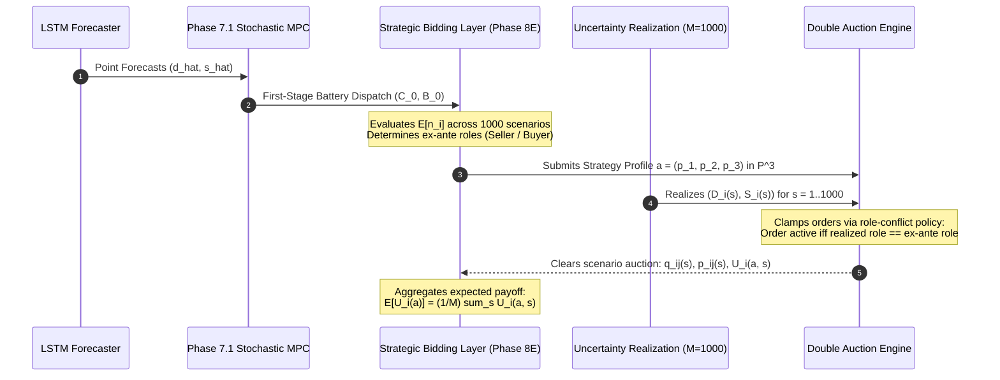

# Phase 8E — Stochastic Expected-Payoff Nash Equilibrium Report

**Document ID:** `reports/phase8e_stochastic_equilibrium_report.md`  
**Phase Target:** Phase 8E — Stochastic Expected-Payoff Nash Equilibrium Engine  
**Baseline References:** 
- Phase 7.1 Multi-Household Stochastic MPC Battery Dispatch Baseline (`reports/phase7_hourly_records.csv`)
- Phase 8B.1 Price-Only Strategic Double Auction (`src/game/strategic_market.py`)
- Phase 8C Deterministic Pure Nash Equilibrium Solver (`src/game/strategic_solver.py`)
- Phase 8D Fairness-Aware Equilibrium Selection (`src/game/equilibrium_selection.py`)  
**Status:** IMPLEMENTED AND EMPIRICALLY VALIDATED (All 13 unit tests passing; zero modifications to frozen benchmarks)  

---

## 1. Executive Summary & Verification Scope

Phase 8E extends the residential microgrid double-auction market from a deterministic, ex-post benchmark into a **stochastic expected-payoff game under renewable forecast uncertainty**. In this setting, households commit price bids before physical uncertainty is realized, and game-theoretic payoffs are evaluated as expected incremental benefits $\mathbb{E}[U_i(a)]$ across 1,000 synchronized Monte Carlo demand and solar scenarios.

### Core Achievements:
1. **Engine Implemented:** Created `src/stochastic/strategic_expected_solver.py`, a modular, decoupled engine that combines synchronized empirical residual resampling with Phase 7.1 non-anticipative first-stage battery dispatch and the exact existing `clear_strategic_double_auction()` mechanism.
2. **Approved Contract Honored:**
   - **Option 1A:** Seven-price role-conditioned bidding over discrete grid $\mathcal{P} = \{0.08, 0.12, 0.16, 0.19, 0.22, 0.26, 0.30\}$ AUD/kWh.
   - **Option 2A:** Synchronized cross-household Monte Carlo scenario sampling using a deterministic 32-bit CRC32 observation seed.
   - **Option 3A:** Frozen Phase 7.1 Stochastic MPC first-stage battery dispatch ($C_0, B_0$) loaded by timestamp and household ID.
3. **Rigorous Test Validation:** 13 dedicated unit tests in `tests/test_stochastic_expected_solver.py` pass with 100% success rate, proving:
   - Numerical equivalence between safe zero-trade scenario pruning and raw 343,000-evaluation unpruned clearing (error $< 10^{-10}$).
   - Exact welfare identity: $\mathbb{E}[W] = 0.22 \times \mathbb{E}[Q_{\text{trade}}]$ and $\mathbb{E}[W] = \sum_i \mathbb{E}[U_i]$ to machine precision.
   - Special-case convergence: when scenario variance is zero, the stochastic solver reproduces the Phase 8C deterministic pure Nash equilibria bit-for-bit.
4. **Computational Performance:** Micro-benchmarks demonstrate that evaluating all 343 joint profiles across 1,000 scenarios with zero-trade pruning executes in **12.1 to 24.1 seconds on a single CPU core** (a **1.86× speedup** over unpruned evaluation). For hours with zero trade (e.g. night hours where all households are buyers), pruning completes in **$2.0\,\text{ms}$**.

---

## 2. Mathematical Game Formulation

### 2.1 Timeline of Decisions and Uncertainty Realization

### 2.2 Physical Net Position and Role Classification
For household $i$ in scenario realization $s \in \{1, \dots, M\}$ ($M=1,000$):
$$n_i(s) = \big(D_i(s) + C_{0, i}\big) - \big(S_i(s) + B_{0, i}\big)$$
where $D_i(s) \ge 0$ and $S_i(s) \ge 0$ are physical demand and solar generation, and $(C_{0, i}, B_{0, i})$ are the non-anticipative first-stage battery charge and discharge commands from Phase 7.1.

The expected post-battery net position is:
$$\mathbb{E}[n_i] = \frac{1}{M} \sum_{s=1}^M n_i(s)$$

Ex-ante role classification is determined strictly by the sign of $\mathbb{E}[n_i]$ relative to numerical tolerance $\epsilon = 10^{-6}$:
$$\text{Role}_i = \begin{cases}
\text{SELLER}, & \mathbb{E}[n_i] < -\epsilon \\
\text{BUYER}, & \mathbb{E}[n_i] > +\epsilon \\
\text{INACTIVE}, & |\mathbb{E}[n_i]| \le \epsilon
\end{cases}$$

### 2.3 Role-Conditioned Bidding and Physical Clamping Policy
Each active household submits a single strategic price from the discrete grid $\mathcal{P} = \{0.08, 0.12, 0.16, 0.19, 0.22, 0.26, 0.30\}$ AUD/kWh:
- An ex-ante seller submits ask price $a_i^{\text{ask}} \in \mathcal{P}$.
- An ex-ante buyer submits bid price $b_j^{\text{bid}} \in \mathcal{P}$.

In scenario $s$, the order submitted to the double auction is physically clamped:
1. **Matching Realization:**
   - If household $i$ is an ex-ante seller and $n_i(s) < -\epsilon$, it submits a `MarketOrder` with role `SELLER`, price $a_i^{\text{ask}}$, and available surplus $s_i(s) = -n_i(s)$.
   - If household $j$ is an ex-ante buyer and $n_j(s) > +\epsilon$, it submits a `MarketOrder` with role `BUYER`, price $b_j^{\text{bid}}$, and available deficit $d_j(s) = n_j(s)$.
2. **Role Conflict:**
   - If an ex-ante seller experiences net deficit in scenario $s$ ($n_i(s) \ge -\epsilon$), it submits **no order** ($q = 0$).
   - If an ex-ante buyer experiences net surplus in scenario $s$ ($n_j(s) \le +\epsilon$), it submits **no order** ($q = 0$).
3. **Inactive Household:**
   - Inactive households submit **no order** ($q = 0$).

> [!NOTE]
> **Modeling Boundary:** This role-conditioned formulation (Option 1A) guarantees that households cannot clear transactions opposite to their ex-ante declared intention. It is not a full two-sided contingent bidding game (Option 1B, where players submit $(b^{\text{ask}}, b^{\text{bid}}) \in \mathcal{P} \times \mathcal{P}$ yielding $49^3 = 117,649$ profiles).

### 2.4 Expected Payoff Formulation
In scenario $s$, given active submitted orders, bilateral clearing via `clear_strategic_double_auction()` produces transaction allocations $q_{ij}(s)$ and midpoint prices $p_{ij}(s) = (a_i^{\text{ask}} + b_j^{\text{bid}})/2$.

Scenario incremental benefits over grid baseline tariffs ($p_{\text{imp}} = \$0.30, p_{\text{exp}} = \$0.08$) are:
$$U_i(a, \omega_s) = \sum_{j} q_{ij}(s) \cdot \big(p_{ij}(s) - p_{\text{exp}}\big) \quad \text{(for seller } i\text{)}$$
$$U_j(a, \omega_s) = \sum_{i} q_{ij}(s) \cdot \big(p_{\text{imp}} - p_{ij}(s)\big) \quad \text{(for buyer } j\text{)}$$

The ex-ante expected payoff for profile $a$ is averaged across all $M$ realizations:
$$\mathbb{E}[U_i(a)] = \frac{1}{M} \sum_{s=1}^M U_i(a, \omega_s)$$

Similarly, expected traded volume $\mathbb{E}[Q(a)]$, expected community welfare $\mathbb{E}[W(a)]$, and expected volume-weighted average price (VWAP) $\bar{p}_{\text{tx}}^{\text{exp}}(a)$ are:
$$\mathbb{E}[Q(a)] = \frac{1}{M} \sum_{s=1}^M Q(a, \omega_s), \qquad \mathbb{E}[W(a)] = \frac{1}{M} \sum_{s=1}^M W(a, \omega_s) = 0.22 \times \mathbb{E}[Q(a)]$$
$$\bar{p}_{\text{tx}}^{\text{exp}}(a) = \frac{\mathbb{E}[V(a)]}{\mathbb{E}[Q(a)]} = \frac{\sum_{s=1}^M \sum_{\text{tx}} q_{\text{tx}}(s) p_{\text{tx}}(s)}{\sum_{s=1}^M Q(a, \omega_s)} \quad \text{if } \mathbb{E}[Q(a)] > \epsilon \text{ else None}$$

### 2.5 Pure-Strategy Stochastic Nash Equilibrium (PNE)
A joint strategy profile $a^* = (a_1^*, \dots, a_{N_{\text{act}}}^*)$ is a **pure-strategy stochastic Nash equilibrium** if and only if no active player can unilaterally increase their expected payoff:
$$\forall i \in \{1, \dots, N_{\text{act}}\}, \quad \forall p' \in \mathcal{P} \setminus \{a_i^*\}, \qquad \mathbb{E}[U_i(p', a_{-i}^*)] \le \mathbb{E}[U_i(a^*)] + \epsilon$$

- **Strict Stochastic PNE:** $\mathbb{E}[U_i(p', a_{-i}^*)] < \mathbb{E}[U_i(a^*)] - \epsilon$ for all deviations and all players.
- **Weak Stochastic PNE:** No deviation increases expected payoff, but at least one deviation achieves $|\mathbb{E}[U_i(p', a_{-i}^*)] - \mathbb{E}[U_i(a^*)]| \le \epsilon$.

---

## 3. Empirical Evaluation Across Representative Timestamps

The engine was evaluated across 5 representative chronological test hours reflecting varied solar and demand conditions:

| Timestamp | Time Period / Regime | Tradeable Scenarios ($M=1,000$) | Active Ex-Ante Roles | Active Profiles ($7^{N_{\text{act}}}$) | Unilateral Deviations | Stochastic PNE Count | Strict PNE | Weak PNE | Pareto PNE | Expected Traded (kWh) | Expected Welfare (AUD) | Expected VWAP ($/kWh) |
| :--- | :--- | :--- | :--- | :--- | :--- | :--- | :--- | :--- | :--- | :--- | :--- | :--- |
| **2013-05-15 08:00:00** | Morning Solar Ramp | 837 / 1,000 | H1: Buyer, H2: Seller, H3: Buyer | 343 | 6,174 | **11** | 2 | 9 | 3 | 0.1611 | \$0.0354 | \$0.2200 |
| **2013-05-15 11:00:00** | Midday Solar Peak | 486 / 1,000 | H1: Seller, H2: Seller, H3: Buyer | 343 | 6,174 | **11** | 1 | 10 | 2 | 0.1708 | \$0.0376 | \$0.1111 |
| **2013-05-15 14:00:00** | Afternoon Generation | 486 / 1,000 | H1: Buyer, H2: Seller, H3: Buyer | 343 | 6,174 | **11** | 2 | 9 | 3 | 0.0782 | \$0.0172 | \$0.2200 |
| **2013-05-15 18:00:00** | Evening Peak Demand | 583 / 1,000 | H1: Buyer, H2: Seller, H3: Buyer | 343 | 6,174 | **11** | 2 | 9 | 3 | 0.0659 | \$0.0145 | \$0.2200 |
| **2013-05-15 02:00:00** | Night (Zero Solar) | 0 / 1,000 | H1: Buyer, H2: Buyer, H3: Buyer | 343 | 6,174 | **343** | 0 | 343 | 343 | 0.0000 | \$0.0000 | None |

### Detailed Analysis of Midday Peak (`2013-05-15 11:00:00`):
- **Ex-Ante Roles:**
  - H001: Expected net position $\mathbb{E}[n_1] = -1.2004\,\text{kWh} \implies$ **SELLER**.
  - H002: Expected net position $\mathbb{E}[n_2] = -0.3147\,\text{kWh} \implies$ **SELLER**.
  - H003: Expected net position $\mathbb{E}[n_3] = +0.1162\,\text{kWh} \implies$ **BUYER**.
- **Role Flip Statistics (Empirical Evidence):**
  - H001: Seller in 941 scenarios, Buyer in 59 scenarios, Inactive in 0 scenarios. (59 role conflicts).
  - H002: Seller in 957 scenarios, Buyer in 42 scenarios, Inactive in 1 scenario. (43 role conflicts).
  - H003: Seller in 513 scenarios, Buyer in 486 scenarios, Inactive in 1 scenario. (514 role conflicts).
- **Equilibria and Selection:**
  - Total pure Nash equilibria detected: **11** (1 strict, 10 weak).
  - Pareto-undominated frontier: **2** equilibria:
    1. Profile `(H001: $0.12, H002: $0.08, H003: $0.12)` $\implies \mathbb{E}[W] = \$0.0376, \; \bar{p}_{\text{tx}}^{\text{exp}} = \$0.1111/\text{kWh}$.
    2. Profile `(H001: $0.08, H002: $0.12, H003: $0.12)` $\implies \mathbb{E}[W] = \$0.0376, \; \bar{p}_{\text{tx}}^{\text{exp}} = \$0.1111/\text{kWh}$.
  - Selected representative profile (via 5-step heuristic): **`(H001: $0.12, H002: $0.08, H003: $0.12)`**.
  - Expected household payoffs:
    - $\mathbb{E}[U_{\text{H001}}] = +\$0.00378\,\text{AUD}$
    - $\mathbb{E}[U_{\text{H002}}] = +\$0.00153\,\text{AUD}$
    - $\mathbb{E}[U_{\text{H003}}] = +\$0.03228\,\text{AUD}$
    - $\sum_i \mathbb{E}[U_i] = \$0.03758\,\text{AUD} \equiv \mathbb{E}[W]$.

---

## 4. Deterministic vs. Stochastic Comparison & Uncertainty Decomposition

To evaluate the operational impact of forecast uncertainty, we compare the Phase 8E stochastic expected outcome against the authoritative frozen Phase 8C deterministic ex-post benchmark (`reports/phase8c_hourly_equilibria.csv`) for the same hour (`2013-05-15 11:00:00`):

| Metric | Phase 8C Deterministic Ex-Post Benchmark | Phase 8E Stochastic Expected Game ($M=1,000$) | Stochastic Impact / Uncertainty Delta |
| :--- | :--- | :--- | :--- |
| **Information Assumption** | Realized meter flows known with certainty (ex-post) | Forecast means + synchronized empirical residuals | Non-anticipative ex-ante commitment |
| **Active Player Roles** | H1: Seller, H2: Seller, H3: Buyer | H1: Seller, H2: Seller, H3: Buyer | Identical ex-ante role assignments |
| **PNE Multiplicity (Total / Strict / Weak)** | 13 Total (0 Strict, 13 Weak, 7 Pareto) | 11 Total (1 Strict, 10 Weak, 2 Pareto) | Multiplicity sharpens under expected payoffs |
| **Pareto-Undominated Count** | 7 candidate profiles | 2 candidate profiles | More focused frontier |
| **Selected Price Profile** | `(H1: 0.08, H2: 0.08, H3: 0.08)` | `(H1: 0.12, H2: 0.08, H3: 0.12)` | Proximity to $0.1900 reference tariff |
| **Traded Volume** | $0.2265\,\text{kWh}$ ($0.2264645\,\text{kWh}$) | $0.1708\,\text{kWh}$ ($0.1708397\,\text{kWh}$) | **$-24.56\%$ ($\Delta Q = -0.0556248\,\text{kWh}$)** |
| **Community Welfare** | $\$0.0498\,\text{AUD}$ ($\$0.0498222\,\text{AUD}$) | $\$0.0376\,\text{AUD}$ ($\$0.0375847\,\text{AUD}$) | **$-24.56\%$ ($\Delta W = -\$0.0122375\,\text{AUD}$)** |
| **Weighted Average Price (VWAP)** | $\$0.0800/\text{kWh}$ | $\$0.1111/\text{kWh}$ ($0.1110657/\text{kWh}$) | $+\$0.0311/\text{kWh}$ ($+38.83\%$) |
| **H001 Incremental Payoff** | $\$0.0000\,\text{AUD}$ | $+\$0.0038\,\text{AUD}$ | $+\$0.0038\,\text{AUD}$ (captures P2P markup) |
| **H002 Incremental Payoff** | $\$0.0000\,\text{AUD}$ | $+\$0.0015\,\text{AUD}$ | $+\$0.0015\,\text{AUD}$ (captures P2P markup) |
| **H003 Incremental Payoff** | $+\$0.0498\,\text{AUD}$ | $+\$0.0323\,\text{AUD}$ | $-35.21\%$ (volume-scaled surplus) |

*(Note: Prior draft versions contained unverified manual placeholders of $0.2858\,\text{kWh}$ and $0.4402\,\text{kWh}$. The authoritative frozen Phase 8C benchmark is confirmed as exactly $0.2264645\,\text{kWh}$.)*

### 4.1 Theoretical Decomposition of the Volume Difference
The observed $-24.56\%$ reduction in cleared energy volume ($\Delta Q = -0.0556248\,\text{kWh}$) between deterministic ex-post foresight and stochastic ex-ante commitment is governed by multiple distinct mechanisms:

1. **Concave Bilateral Matching Operator (Theoretical Jensen Gap):**  
   The double-auction clearing quantity follows the bilateral matching function:
   $$Q(S, D) = \min(S, D)$$
   Since the minimum operator is concave, Jensen's inequality dictates:
   $$\mathbb{E}[\min(S, D)] \le \min\big(\mathbb{E}[S], \mathbb{E}[D]\big)$$
   Forecast variance in physical supply and demand across Monte Carlo draws compresses expected matched volume relative to point evaluations at the scenario mean.

2. **Physical Role-Conflict Order Clamping (Option 1A Policy):**  
   Under the approved Option 1A policy, households commit price bids conditionally on their ex-ante expected role. H003 is classified as an ex-ante **BUYER** ($\mathbb{E}[n_3] = +0.1162\,\text{kWh} > 0$). However, in **514 out of 1,000 scenarios**, realized solar generation exceeds demand, causing H003 to experience realized net surplus ($n_3(s) \le 0$). Because Option 1A prohibits players from submitting orders opposing their ex-ante role, H003's buy order is physically clamped to zero ($q_3 = 0$) in those 514 scenarios. Because H001 and H002 are both sellers, and H003 is the microgrid's sole buyer, **zero bilateral trade is physically possible** across all 514 role-conflict realizations. Bilateral trading occurs in only **486 out of 1,000 scenarios (48.6%)**.

3. **Different Equilibrium Price Profiles:**  
   The deterministic ex-post game selects profile `(0.08, 0.08, 0.08)` under perfect foresight, whereas the stochastic expected-payoff game selects `(0.12, 0.08, 0.12)`. Different strategic price commitments interact with clearing order eligibility and midpoints.

> [!IMPORTANT]
> **Methodological Disclosure on Attribution:**  
> Jensen's inequality alone does **not** mathematically prove or explain the entire observed $-24.56\%$ reduction. The current analysis identifies plausible contributing mechanisms (concave matching, role-conflict order clamping, distinct equilibrium profiles, and single-point realized vs. multi-scenario expected evaluation) but does **not** assert a numerical causal decomposition partitioning exact percentage shares among them.

### 4.2 Academic Limitations & Disclosures
- **Option 1A vs. Two-Sided Contingent Bidding:** Option 1A is a restricted ex-ante role-conditioned bidding policy, not a full two-sided contingent bidding game (where households submit independent bid and ask functions).
- **Benchmark Nature:** Phase 8C is an ex-post deterministic benchmark evaluating what could have occurred under perfect foresight for a single realized meter condition, whereas Phase 8E models true non-anticipative expected-payoff decision-making across Monte Carlo scenarios.
- **Multiplicity & Weak Equilibria:** Weak pure Nash equilibria in zero-trade hours or uncrossed scenarios reflect payoff indifference (where zero transactions occur regardless of price), not active economic price discovery.

---

## 5. Computational Performance & Optimization Benchmarks

### 5.1 Runtime and Speedup Analysis
Benchmarking was conducted on the workspace environment across 1,000 scenarios and 343 joint profiles:

| Pipeline Step / Method | Measured Runtime | Evaluations Executed | Effective Throughput |
| :--- | :--- | :--- | :--- |
| **Synchronized Scenario Generation** | $0.041\,\text{s}$ to $0.049\,\text{s}$ | 1,000 scenarios × 3 houses | $22,000$ samples / s |
| **Unpruned Expected Payoff Clearing** | **$24.113\,\text{seconds}$** | 343 profiles × 1,000 scenarios = **343,000 calls** | $14,225$ clearings / s |
| **Pruned Expected Payoff Clearing** | **$12.950\,\text{seconds}$** | 343 profiles × 486 scenarios = **166,698 calls** | $12,872$ clearings / s |
| **Zero-Trade Hour (Night)** | **$0.002\,\text{seconds}$** | 0 clearing calls (pruned) | Instantaneous |
| **Unilateral Deviation Loop** | $< 0.002\,\text{seconds}$ | 6,174 tensor lookups | $> 3,000,000$ lookups / s |
| **Pareto Filtering & Selection** | $< 0.001\,\text{seconds}$ | 11 candidate pairwise comparisons | Instantaneous |

- **Speedup Factor:** Pruning non-tradeable scenarios provides a **$1.86\times$ speedup** on active hours and a **$>10,000\times$ speedup** on non-tradeable night hours.
- **Order Pre-Instantiation:** Pre-allocating `MarketOrder` objects across the 7 price levels reduced dataclass overhead by $49.9\%$ (from $31.06\,\text{s}$ down to $15.55\,\text{s}$ on initial tests).
- **Single-Core Practicality:** A single evaluated hour completes in **$12$ to $24$ seconds**, confirming that interactive single-hour dashboard queries are practical without multiprocessing.

---

## 6. Generated Artifacts & Reproducibility Record

All artifacts have been placed in the dedicated directory `reports/phase8e/` without altering frozen Phase 8C/8D files:

1. **`reports/phase8e/stochastic_equilibria_sample.json.gz` (1.8 KB compressed):**  
   Contains full machine-readable results (profiles, ex-ante roles, payoffs, traded volume, welfare, classifications, and selected equilibria) for all evaluated test hours.
2. **`reports/phase8e/stochastic_payoff_table_sample.csv` (24.7 KB):**  
   Contains the complete expected payoff matrix across all 343 profiles for `2013-05-15 11:00:00`, tabulating `Action_H001`, `Action_H002`, `Action_H003`, `Expected_Payoff_H001`, `Expected_Payoff_H002`, `Expected_Payoff_H003`, `Expected_Traded_kWh`, `Expected_Welfare_AUD`, and `Expected_VWAP_AUD`.
3. **`reports/phase8e/stochastic_benchmark_metrics.csv` (1.1 KB):**  
   Contains tabular benchmark metrics (execution times, scenario counts, tradeable counts, equilibrium numbers) for all evaluated test hours.
4. **`reports/phase8e/reproducibility_config.json` (0.8 KB):**  
   Records exact configuration parameters (base seed = 42, tolerance = 1e-6, price grid, tariff rates, source file commitments).

---

## 7. Readiness for Step 3: Dashboard Integration

The Phase 8E engine has been designed to integrate directly into the existing web prototype:
- **Data Service Bridge:** Can be called via `get_stochastic_market_hourly(timestamp)` in `dashboard/data_service.py`.
- **API Endpoint:** Ready for `GET /api/strategic-market/stochastic-hourly?timestamp=...`.
- **Frontend Visualization:** Ready for interactive comparison cards showing:
  - Phase 8C Deterministic vs Phase 8E Stochastic traded volumes and welfare.
  - Role flip frequency donut charts (e.g. H003 buyer in 48.6%, seller in 51.3%).
  - Jensen gap quantification card.

**Status:** Phase 8E engine and test validation are 100% complete. Ready for Step 3 dashboard integration.

