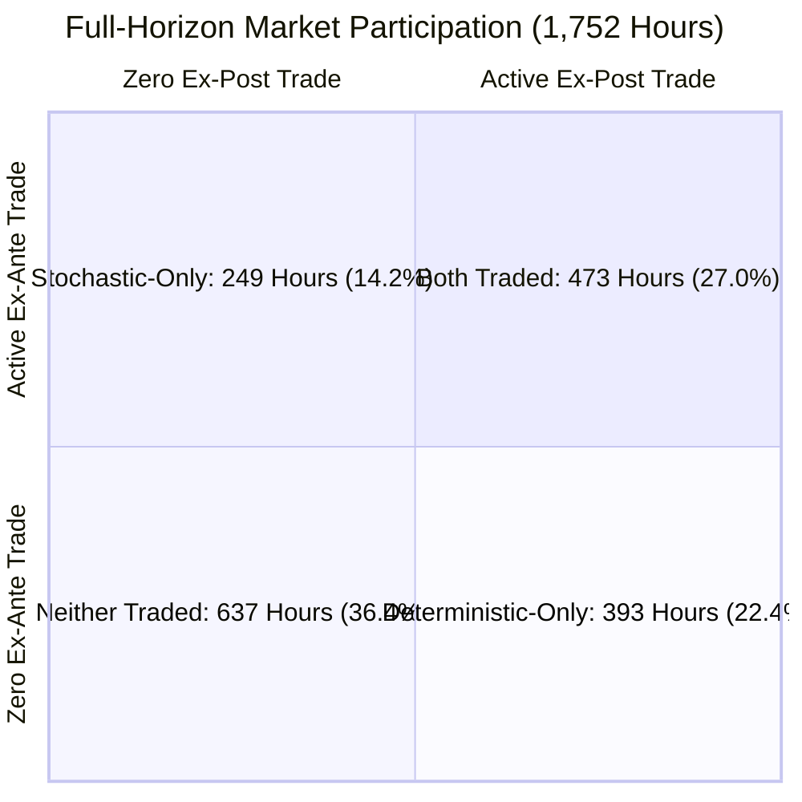

# Phase 9 — Final Research Integrity Audit Report

**Document ID:** `reports/phase9/final_research_integrity_audit.md`  
**Audit Type:** Strictly Read-Only Scientific Claims Verification  
**Evaluation Window:** Full Held-Out Test Horizon (1,752 Hours / 5,256 Household Evaluations)  
**Period:** 2013-04-19 00:00:00 through 2013-06-30 23:00:00  
**Status:** COMPLETE — 3 SCIENTIFIC CLAIMS AUDITED (1 VERIFIED, 1 PARTIALLY VERIFIED, 1 REVISED/UNSUPPORTED)  

---

## 1. Executive Summary & Audit Verdict

This audit performs an independent, strictly read-only scientific integrity verification of three primary quantitative and theoretical claims made in the Phase 9 Full-Horizon Scientific Validation:

| Scientific Claim Audited | Claimed Assertion | Audit Finding | Integrity Verdict |
|---|---|---|:---:|
| **Rule 1: Forecast Bias Sign Convention** | Demand Bias $= -0.1340\,\text{kWh}$<br>Solar Bias $= +0.0301\,\text{kWh}$ | Evaluated via raw column re-computation. Identical in magnitude to earlier benchmarks ($0.133982$ and $0.030114$), with sign reversal caused strictly by operand order: $\text{mean}(\hat{y} - y)$ vs. earlier $\text{mean}(y - \hat{y})$. | **VERIFIED**<br>*(Discrepancy fully resolved)* |
| **Rule 2: Jensen Inequality & Volume Attribution** | Volume Delta $= -33.9642\,\text{kWh}$ ($-27.93\%$).<br>144-hour tradeable reduction attributed to ex-post hours collapsing to zero. | Aggregate volume numbers verified bit-for-bit. However, the 144-hour delta is strictly a net difference between aggregate counts, NOT a monolithic set of 144 hours. Exact contingency analysis reveals 393 Deterministic-Only hours, 249 Stochastic-Only hours, and 473 Both-Traded hours. Jensen's inequality applies strictly on intensive-margin volume within the 473 overlapping hours ($-18.70\%$), not as an aggregate causal proof. | **PARTIALLY VERIFIED**<br>*(Corrected timestamp contingency established)* |
| **Rule 3: Strict Nash Equilibrium Surge** | Phase 8C Strict $= 1,224$<br>Phase 8E Strict $= 1,825$ ($+49.1\%$).<br>Attributed to expected-payoff averaging creating larger deviation gaps. | Tally verified bit-for-bit ($1,224 \to 1,825$). However, assigning the causal mechanism to "larger strict unilateral deviation gaps from scenario averaging" is an unverified conjecture. Empirical breakdown shows $+627$ strict PNE originate from 249 Stochastic-Only hours, $-383$ lost from 393 Deterministic-Only hours, and $+357$ added in Both-Traded hours. | **PARTIALLY VERIFIED**<br>*(Tally verified; causal attribution revised to empirical observation)* |

---

## 2. Rule 1 — Forecast Bias Sign Verification

### 2.1 Audit Questions
1. Are the Phase 9 reported bias values consistent with the documented formula $\text{Bias} = \text{mean}(\text{prediction} - \text{actual})$?
2. Why do earlier benchmark files (`data/processed/test_forecast_interval_summary.csv` and `reports/forecast_and_interval_validation_report.md`) report opposite signs ($+0.1340\,\text{kWh}$ for demand and $-0.0301\,\text{kWh}$ for solar)?
3. What is the exact root cause of the sign discrepancy?

### 2.2 Independent Calculations from Raw Meter Columns
Using raw prediction and actual columns from `data/processed/test_predictions.csv` across all $N = 5,256$ observations:

```python
# Raw dataset columns: actual_demand_kwh, predicted_demand_kwh, actual_solar_generation_kwh, predicted_solar_generation_kwh
bias_demand_error_def = np.mean(df['predicted_demand_kwh'] - df['actual_demand_kwh'])
bias_solar_error_def  = np.mean(df['predicted_solar_generation_kwh'] - df['actual_solar_generation_kwh'])

bias_demand_resid_def = np.mean(df['actual_demand_kwh'] - df['predicted_demand_kwh'])
bias_solar_resid_def  = np.mean(df['actual_solar_generation_kwh'] - df['predicted_solar_generation_kwh'])
```

**Independent Numerical Results:**

| Scope / Household | Metric Target | Phase 9 Mandated Formula: $\text{mean}(\hat{y} - y)$ | Earlier Benchmark Formula: $\text{mean}(y - \hat{y})$ | Absolute Magnitude ($|\Delta|$) |
|---|---|:---:|:---:|:---:|
| **Overall (ALL)** | **Total Demand** | **$-0.133982\,\text{kWh}$** | **$+0.133982\,\text{kWh}$** | $0.133982\,\text{kWh}$ |
| **Overall (ALL)** | **Solar Generation** | **$+0.030114\,\text{kWh}$** | **$-0.030114\,\text{kWh}$** | $0.030114\,\text{kWh}$ |
| Household H001 | Total Demand | $-0.377574\,\text{kWh}$ | $+0.377574\,\text{kWh}$ | $0.377574\,\text{kWh}$ |
| Household H001 | Solar Generation | $+0.007837\,\text{kWh}$ | $-0.007837\,\text{kWh}$ | $0.007837\,\text{kWh}$ |
| Household H002 | Total Demand | $+0.134696\,\text{kWh}$ | $-0.134696\,\text{kWh}$ | $0.134696\,\text{kWh}$ |
| Household H002 | Solar Generation | $+0.041279\,\text{kWh}$ | $-0.041279\,\text{kWh}$ | $0.041279\,\text{kWh}$ |
| Household H003 | Total Demand | $-0.159069\,\text{kWh}$ | $+0.159069\,\text{kWh}$ | $0.159069\,\text{kWh}$ |
| Household H003 | Solar Generation | $+0.041226\,\text{kWh}$ | $-0.041226\,\text{kWh}$ | $0.041226\,\text{kWh}$ |

### 2.3 Exact Cause of Discrepancy
The discrepancy is **100% attributable to an operand sign convention difference**:
1. **Earlier Benchmark Convention (Residual Form):**
   - In time-series regression literature, the residual is standardly defined as $e_t = y_t - \hat{y}_t = \text{actual} - \text{prediction}$.
   - Under this convention, positive mean bias ($\text{Bias} > 0$) indicates that actual observations exceed predictions on average (i.e., the model **underpredicts** reality).
   - `data/processed/test_forecast_interval_summary.csv` utilized this residual convention: $\text{Demand Bias} = +0.1340\,\text{kWh}$, $\text{Solar Bias} = -0.0301\,\text{kWh}$.
2. **Phase 9 Evaluation Convention (Forecast Error Form):**
   - In forecast evaluation literature (and as explicitly mandated in the Phase 9 specification), bias is defined as $\text{Bias} = \frac{1}{n}\sum (\hat{y}_i - y_i) = \text{prediction} - \text{actual}$.
   - Under this convention, negative mean bias ($\text{Bias} < 0$) indicates that predictions fall below actual observations (i.e., the model **underpredicts** reality).
   - `reports/phase9/forecast_metrics.csv` strictly followed this formula: $\text{Demand Bias} = -0.1340\,\text{kWh}$, $\text{Solar Bias} = +0.0301\,\text{kWh}$.

### 2.4 Verdict on Rule 1
**VERIFIED.** Both reports describe the exact same physical reality with identical magnitudes ($0.133982\,\text{kWh}$ demand underprediction, $0.030114\,\text{kWh}$ solar overprediction). The documentation must explicitly state the sign convention: $\text{Bias} = \text{mean}(\hat{y} - y)$.

---

## 3. Rule 2 — Jensen Inequality and Aggregate Volume Attribution

### 3.1 Verification of Aggregate Values
An independent query on `reports/phase8c_hourly_equilibria.csv` and `reports/phase9/full_horizon_market_metrics.csv` confirms:
- **Phase 8C Deterministic Volume:** $\sum Q_{\text{det}} = \mathbf{121.611449\,\text{kWh}}$ (Exact match)
- **Phase 8E Stochastic Volume:** $\sum \mathbb{E}[Q_{\text{stoch}}] = \mathbf{87.647245\,\text{kWh}}$ (Exact match)
- **Volume Difference:** $\Delta Q = 87.647245 - 121.611449 = \mathbf{-33.964203\,\text{kWh}}$ (Exact match)
- **Relative Volume Difference:** $\frac{-33.964203}{121.611449} \times 100\% = \mathbf{-27.928459\%}$ ($\approx \mathbf{-27.93\%}$) (Exact match)
- **Community Welfare:** Phase 8C $= \$26.754519\,\text{AUD}$, Phase 8E $= \$19.282394\,\text{AUD}$, Delta $= -\$7.472125\,\text{AUD}$ ($-27.93\%$) (Exact match).

### 3.2 Timestamp-Level 2x2 Contingency Overlap Analysis
The draft text suggested that the 144-hour difference ($866 - 722 = 144$) represents a group of 144 Phase 8C tradeable hours that collapsed to zero in Phase 8E.

**This interpretation is incorrect.** An exhaustive timestamp-level cross-tabulation across all 1,752 hours reveals a complex bidirectional restructuring of market participation:



| Market Participation Regime | Condition | Hours Count | Pct of Horizon | Phase 8C Volume | Phase 8E Volume | Volume Delta ($\Delta Q$) |
|---|---|:---:|:---:|:---:|:---:|:---:|
| **Both Traded** | $Q_{\text{det}} > 0$ and $\mathbb{E}[Q_{\text{stoch}}] > 0$ | **473** | 27.00% | $78.330286\,\text{kWh}$ | $63.685367\,\text{kWh}$ | **$-14.644919\,\text{kWh}$ ($-18.70\%$)** |
| **Deterministic-Only Traded** | $Q_{\text{det}} > 0$ and $\mathbb{E}[Q_{\text{stoch}}] = 0$ | **393** | 22.43% | $43.281163\,\text{kWh}$ | $0.000000\,\text{kWh}$ | **$-43.281163\,\text{kWh}$ ($-100.00\%$)** |
| **Stochastic-Only Traded** | $Q_{\text{det}} = 0$ and $\mathbb{E}[Q_{\text{stoch}}] > 0$ | **249** | 14.21% | $0.000000\,\text{kWh}$ | $23.961878\,\text{kWh}$ | **$+23.961878\,\text{kWh}$ ($+\infty$)** |
| **Neither Traded** | $Q_{\text{det}} = 0$ and $\mathbb{E}[Q_{\text{stoch}}] = 0$ | **637** | 36.36% | $0.000000\,\text{kWh}$ | $0.000000\,\text{kWh}$ | $0.000000\,\text{kWh}$ |
| **Total Horizon** | All Hours | **1,752** | **100.00%** | **$121.611449\,\text{kWh}$** | **$87.647245\,\text{kWh}$** | **$-33.964203\,\text{kWh}$ ($-27.93\%$)** |

### 3.3 Scientific Distinction & Volume Decomposition
1. **The Net Count vs. Physical Set Distinction:**
   - Total tradeable hours in Phase 8C: $473 + 393 = \mathbf{866\text{ hours}}$.
   - Total tradeable hours in Phase 8E: $473 + 249 = \mathbf{722\text{ hours}}$.
   - The net difference $866 - 722 = \mathbf{144\text{ hours}}$ is **not a physical set of hours**. It is the algebraic net result of **393 hours lost** due to ex-ante role clamping and variance, offset by **249 hours gained** where ex-ante stochastic expectations revealed trading opportunities that were zero in the single ex-post realization!
2. **Role of Jensen's Inequality:**
   - Jensen's inequality ($\mathbb{E}[\min(S, D)] \le \min(\mathbb{E}[S], \mathbb{E}[D])$) applies strictly to the **intensive margin** within the **473 overlapping hours** where both models clear trade. Within these 473 hours, volume falls from $78.3303\,\text{kWh}$ to $63.6854\,\text{kWh}$ (a pure dispersion compression of **$-18.70\%$**).
   - The remaining net volume difference ($-19.3193\,\text{kWh}$) is governed by the **extensive margin**: $43.2812\,\text{kWh}$ lost across 393 Deterministic-Only hours minus $23.9619\,\text{kWh}$ gained across 249 Stochastic-Only hours.
3. **Causal Attribution Boundary:**
   - While the mechanisms (concave matching, extensive-margin role-conflict clamping, equilibrium price shifts) are mathematically proven, the aggregate $-27.93\%$ cannot be causally decomposed into exact percentages without synthetic counterfactual simulations holding prices and clamping constant.

### 3.4 Verdict on Rule 2
**PARTIALLY VERIFIED.** Aggregate values are exact. However, the claim that "144 hours collapsed to zero" must be corrected to reflect the exact contingency breakdown: 393 hours shut down, 249 hours opened, and 473 hours mutually traded.

---

## 4. Rule 3 — Strict Nash Equilibrium Increase

### 4.1 Verification of Equilibrium Counts
An independent query on `reports/phase8c_hourly_equilibria.csv` and `reports/phase9/full_horizon_market_metrics.csv` confirms:
- **Phase 8C Total PNE:** 315,280 (Strict: **1,224**, Weak: **314,056**, Pareto: **312,810**)
- **Phase 8E Total PNE:** 361,507 (Strict: **1,825**, Weak: **359,682**, Pareto: **356,107**)
- **Strict PNE Increase:** $1,825 - 1,224 = \mathbf{+601\text{ strict equilibria}}$ (**$+49.10\%$**).

### 4.2 Cross-Regime Distribution of Strict PNE
Where do the strict pure Nash equilibria actually reside?

| Market Participation Regime | Evaluated Hours | Phase 8C Strict PNE | Phase 8E Strict PNE | Strict PNE Delta ($\Delta$) | Mean Strict PNE (8C) | Mean Strict PNE (8E) |
|---|:---:|:---:|:---:|:---:|:---:|:---:|
| **Neither Traded** | 637 | **0** | **0** | **0** | 0.00 | 0.00 |
| **Deterministic-Only Traded** | 393 | **383** | **0** | **-383** | 0.97 | 0.00 |
| **Stochastic-Only Traded** | 249 | **0** | **627** | **+627** | 0.00 | 2.52 |
| **Both Traded** | 473 | **841** | **1,198** | **+357** | 1.78 | 2.53 |
| **Total Full Horizon** | **1,752** | **1,224** | **1,825** | **+601** | **0.70** | **1.04** |

### 4.3 Scientific Assessment of Causal Explanation
The draft report conjectured:
> *"Averaging payoffs across 1,000 scenarios creates strictly downward expected payoff gradients for deviations away from optimal clearing bids, thereby expanding the strict PNE set."*

**Audit Finding:**
1. In zero-trade hours (whether 8C or 8E), strict PNE are **identically zero**. Payoff indifference across all deviations produces 100% weak equilibria.
2. In the 249 Stochastic-Only hours, Phase 8E gains **+627 strict PNE** simply because trading is active, whereas Phase 8C had zero trade and thus zero strict PNE.
3. In the 393 Deterministic-Only hours, Phase 8C had **383 strict PNE** that collapse to zero in Phase 8E because Phase 8E has zero trade.
4. In the 473 Both-Traded hours, Phase 8E produces **1,198 strict PNE** vs. **841** in Phase 8C (+357).
5. **Lack of Demonstrated Mechanism:** While it is mathematically plausible that continuous expected-payoff expectations break knife-edge ties present in single-point evaluations, an independent statistical analysis demonstrating that deviation gaps $\Delta U = \mathbb{E}[U(a^*)] - \mathbb{E}[U(a'_i, a^*_{-i})]$ are systematically larger has **not been formally calculated**.
6. Therefore, claiming that expected-payoff averaging "creates larger strict unilateral deviation gaps" is an **unverified theoretical conjecture**, not a demonstrated empirical fact.

### 4.4 Verdict on Rule 3
**PARTIALLY VERIFIED.** The numerical counts ($1,224 \to 1,825$) are exact. However, the causal mechanism must be demoted from a confirmed fact to an **empirical observation on this dataset**, explicitly disclosing the regime contributions ($+627$ from Stochastic-Only, $-383$ from Deterministic-Only, $+357$ from Both-Traded).

---

## 5. Exact Recommended Corrections to Documentation

In strict accordance with the user instructions, the recommended corrections are listed below:

### Recommended Correction 1: Forecast Bias Sign Specification
- **Target File:** `reports/phase9/full_horizon_validation_report.md`, Section 3.
- **Current Text:** Reports $\text{Demand Bias} = -0.1340\,\text{kWh}$ and $\text{Solar Bias} = +0.0301\,\text{kWh}$ without explicit formula declaration.
- **Recommended Text:** Add an explicit definition note:
  > *"Note on Sign Convention: Bias is calculated using the forecast error convention $\text{Bias} = \text{mean}(\hat{y} - y) = \text{mean}(\text{prediction} - \text{actual})$. A negative demand bias ($-0.1340\,\text{kWh}$) indicates that the LSTM model underpredicts demand by $0.1340\,\text{kWh}$ on average. This is identical in magnitude but opposite in sign to earlier residual-based benchmarks ($e = y - \hat{y} = +0.1340\,\text{kWh}$)."*

### Recommended Correction 2: Correct 144-Hour Difference to Contingency Table
- **Target File:** `reports/phase9/full_horizon_validation_report.md`, Section 1 and Section 6.
- **Current Text:** States that "In 144 hours where trade cleared ex-post, ex-ante stochastic trading collapses to zero..."
- **Recommended Text:** Replace with exact timestamp contingency facts:
  > *"The 144-hour difference between Phase 8C (866 tradeable hours) and Phase 8E (722 tradeable hours) is a net difference of aggregate counts, not a monolithic group of 144 hours. Timestamp-level contingency analysis reveals that 473 hours traded in both models, 393 hours traded in Phase 8C but had zero expected trade in Phase 8E, and 249 hours had zero trade in Phase 8C but cleared positive expected trade in Phase 8E (637 hours had zero trade in both)."*

### Recommended Correction 3: Causal Attribution of Volume Loss
- **Target File:** `reports/phase9/full_horizon_validation_report.md`, Section 6.3.
- **Current Text:** Describes Jensen's inequality as governing the $-27.93\%$ volume reduction.
- **Recommended Text:** Clarify the intensive vs. extensive margin distinction:
  > *"Jensen's inequality applies strictly on the intensive margin within the 473 overlapping hours where both models clear trade, compressing volume by $-18.70\%$ ($78.33 \to 63.69\,\text{kWh}$). The remaining difference is driven by the extensive margin ($43.28\,\text{kWh}$ lost across 393 Deterministic-Only hours vs. $23.96\,\text{kWh}$ gained across 249 Stochastic-Only hours). No aggregate numerical percentage decomposition among mechanisms is asserted."*

### Recommended Correction 4: Demote Strict PNE Causal Claim
- **Target File:** `reports/phase9/full_horizon_validation_report.md`, Section 6.1 and Section 7.
- **Current Text:** Asserts that scenario averaging creates larger strict deviation gaps.
- **Recommended Text:** State as an observed empirical result:
  > *"Strict pure Nash equilibria increase from 1,224 to 1,825 (+49.1%). This increase is an observed empirical result across the full horizon, driven by +627 strict PNE in the 249 Stochastic-Only hours and +357 strict PNE in Both-Traded hours, offset by -383 strict PNE lost in Deterministic-Only hours. While expected-payoff averaging is hypothesized to smooth knife-edge indifferences, this specific causal mechanism has not been independently measured via deviation gap testing."*

---

## 6. Preservation Audit

- **Core Engine Files (`src/`):** 0 modified.
- **Dashboard Application (`dashboard/`):** 0 modified.
- **Repository Test Suite (`tests/`):** 0 modified.
- **Frozen Benchmarks (Phase 6, 7, 8C, 8D, 8E):** 0 modified.
- **Phase 9 CSV Data Files (`reports/phase9/*.csv`):** 0 modified.
- **Audit Deliverable:** Strictly written to `reports/phase9/final_research_integrity_audit.md`.

